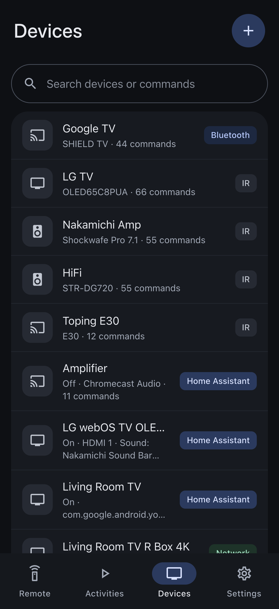
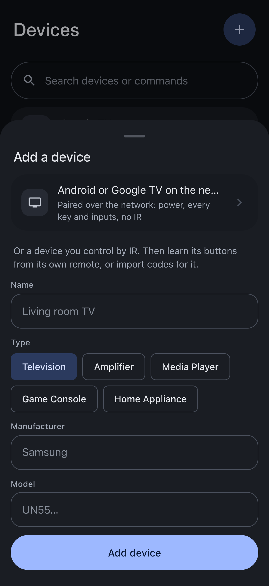
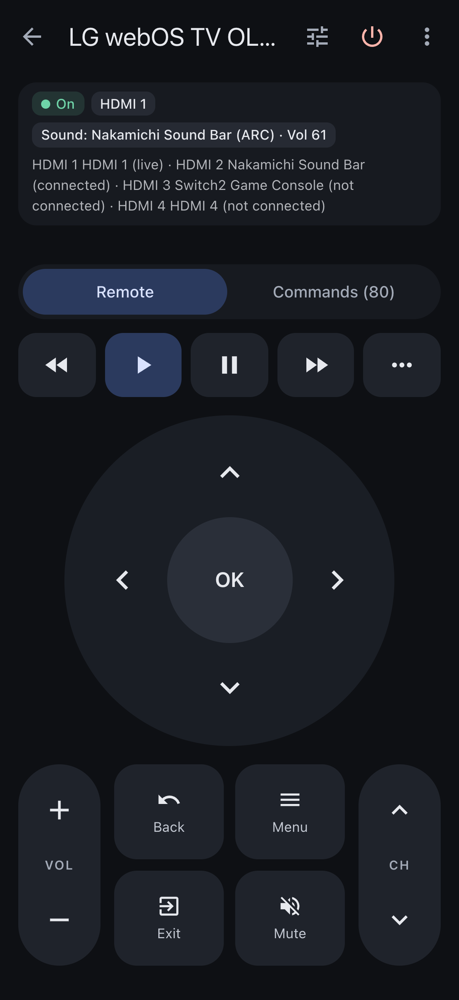
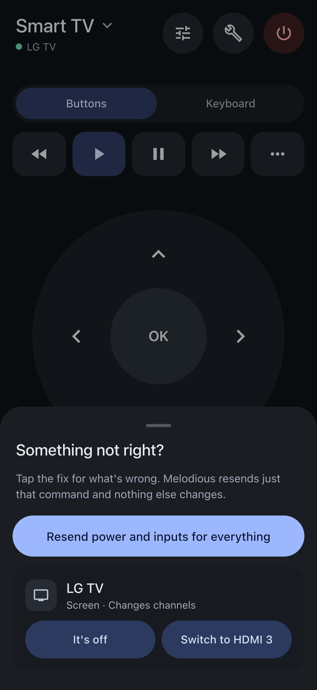
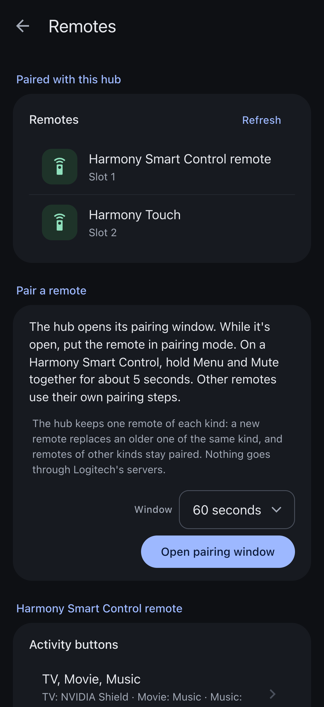
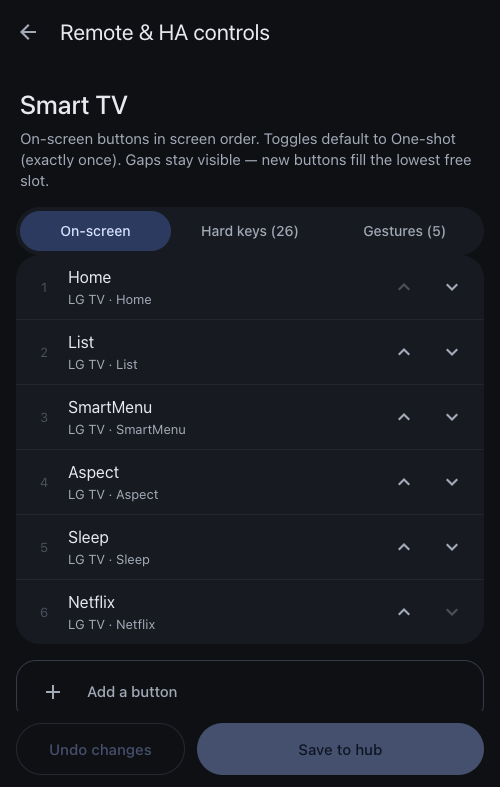
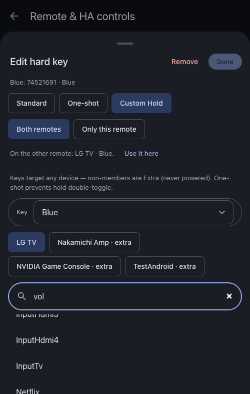

<p align="center">
  
</p>

<h1 align="center">Melodious</h1>

<p align="center">
  Local control for the Logitech Harmony Hub and its remotes, connected to Home Assistant in both directions.<br>
  No Logitech app, account or cloud.
</p>

<p align="center">
  <a href="#quick-start">Quick start</a> ·
  <a href="#harmony">Harmony</a> ·
  <a href="#home-assistant">Home Assistant</a> ·
  <a href="#buttons-gestures-and-timing">Buttons and timing</a> ·
  <a href="#the-apps">Apps</a> ·
  <a href="#how-it-works">How it works</a> ·
  <a href="docs/API.md">API</a>
</p>

Melodious runs on a Harmony Hub already rooted with
[harmony-hub-root](https://github.com/Ripthulhu/harmony-hub-root), next to Logitech's own firmware. It
takes over the cloud's jobs (devices, activities, remote sync) and connects the hub and Home Assistant
both ways. Set it up from the hub's web app, the Android app or the macOS app.

This repository contains no rooting tools, exploits, private keys or personal backups.

<p align="center">
  
  
  <br><sub>The web app (left) and the Android app (right)</sub>
</p>

## At a glance

<table>
<tr>
<th width="50%">Harmony</th>
<th width="50%">Home Assistant</th>
</tr>
<tr>
<td valign="top">

- Runs offline. Logitech's cloud is blocked, and the paired remote syncs from the hub.
- Activities, devices, inputs and power order, all edited on the hub.
- IR learning, and code import from IRDB, Flipper files, Pronto, RemoteCentral or Logitech's
  catalog.
- Any command can go on a hard key, an on-screen button, the number pad or a gesture.
- The hub can also act as a Bluetooth keyboard and remote for TVs and streaming boxes.
- Android TV and Google TV sets pair over the network: power on and off from standby, every key and
  inputs, with no IR.
- Optional wired Ethernet over a self-powered OTG micro-USB Realtek adapter
  ([USB_ETHERNET.md](docs/USB_ETHERNET.md)).

</td>
<td valign="top">

- Whole devices (LG webOS, Google/Android TV, AVRs, Cast) merge into one Harmony device — power,
  volume, inputs, apps, transport, D-pad — or expose single entities (lights, switches, fans,
  covers, scripts, scenes, buttons). Use them in activities, on any button, or on their own screen;
  hold to dim/ramp, toggles fire once.
- **Live two-way state:** power, input, volume, mute, playback and app (plus LG HDMI/CEC/ARC theater
  state and display-only port links) pushed to the hub's RAM and shown in the apps and Fix It.
- **Smart startup:** no redundant `PowerOn`/input switch for a device already on, or already on the
  wanted input.
- **The hub is a `remote` entity** (`turn_on`/`turn_off`/`send_command` for IR, Bluetooth and HA
  devices alike), and every Harmony press on an HA device fires `melodious.command_received` for
  automations.
- **Hub devices in Home Assistant:** mirror hub-only devices (IR, Bluetooth, network) into HA as
  power switches, input selectors, command buttons and activity sensors — opt-in per device.
- MQTT discovery (activity selector, status sensors, Power Off), and HA's built-in Harmony
  integration keeps working locally.

</td>
</tr>
</table>

Both sides share the same apps, the same button mapping and the same save path. To the hub, an IR
code, a Bluetooth key and a Home Assistant action are all ordinary device commands.

## Why Melodious

Logitech stopped making Harmony remotes in 2021, yet a Hub still needs its app/cloud to add devices,
build activities and update the remote — lose that service and your setup is frozen. Melodious moves
the work on-hub (keeping Logitech's IR/activity/remote engine), with your setup in local files you
can back up, restore and edit account-free.

## Requirements

| Requirement | Details |
| --- | --- |
| Harmony Hub | Rooted with [harmony-hub-root](https://github.com/Ripthulhu/harmony-hub-root). Melodious doesn't root hubs. |
| SSH key | The root tool's private key, `harmony_owner_*`, in `~/.ssh` (`%USERPROFILE%\.ssh` on Windows). |
| Hub ID | The numeric Hub ID the root tool prints. Don't guess it: Melodious sends it with every command to the hub's engine. |
| Free flash | About 1.4 MB of the hub's 5 MB data flash for the first install (about 1 MB if the root tool's Dropbear can be reused); each later web app update needs about 0.65 MB. The installer measures it and stops before writing anything if there isn't enough — see [docs/INSTALL.md](docs/INSTALL.md#if-the-hubs-flash-is-full). |
| Install computer | Windows with PowerShell, Linux or macOS with Python 3, or a Docker or Unraid host. The installer needs only `ssh`, not `scp` or `sftp`. |
| Network | A trusted home network. The web app is plain HTTP. |
| Home Assistant (optional) | Any recent Home Assistant with [HACS](https://hacs.xyz/), reachable from the hub over plain `http://`. An MQTT broker is needed only for the MQTT bridge. |
| Android app (optional) | Android 8.0 or later. Building it needs JDK 17 or 21 and the Android SDK. |
| macOS app (optional) | macOS 13 or later, on Apple silicon or Intel. Catalog lookup needs a Logitech account; building the app needs Node.js. |

## Quick start

1. Root the hub with harmony-hub-root. Keep the SSH key it creates (`harmony_owner_*` in `~/.ssh`)
   and the numeric Hub ID it prints.
2. Download `melodious-hub-<version>.zip` from the [latest
   release](https://github.com/schlambos/harmony-hub-control/releases/latest) and unzip it, or clone
   this repository. From a computer on the same network, install Melodious:

   ```bash
   python3 install_webui.py --hub-host <hub-ip> --hub-id <hub-id>
   ```

   On Windows, double-click `Install_Harmony_Control.cmd`, or in PowerShell:

   ```powershell
   .\install_webui.ps1 -HubHost <hub-ip> -HubId <hub-id>
   ```

   The first install turns on the cloud blocker, leaves MQTT off, and reboots the hub once.
3. Open `http://<hub-ip>:8080/` on your phone or computer. Your existing activities and devices are
   there, including any set up with the Logitech app before rooting.
4. Optional: add Home Assistant (see [Set up Home Assistant](#set-up-home-assistant)).

## Harmony

### Offline operation

- **The cloud is blocked.** Logitech's cloud tasks don't start, Logitech/PubNub requests fail
  cleanly, and the internet route is removed — LAN, SSDP/mDNS discovery, MQTT and Home Assistant
  keep working.
- **The paired remote syncs from the hub.** Each save publishes a new revision, which the remote
  pulls within seconds — no MyHarmony account and no cloud copy to overwrite your edits.
- **Syncs finish offline:** the connectivity, time and device-content checks along the way are all
  answered locally.
- **The hub keeps its own time** over NTP (temporary route per query); set the time zone in System.
- **Local edits are protected:** System → Cloud egress turns the blocker on (there's no off
  control), and activity/device edits are refused while it's off.

### Remotes

Designed for any remote that pairs with the hub; **validated on the Harmony Touch and Smart Control,
and a user reports the Harmony Elite works.**

| Remote | Status |
| --- | --- |
| Harmony Touch | Validated, with stock remote firmware: offline sync, hard keys, on-screen buttons, the number pad, gestures, device screens and press modes. |
| Harmony Smart Control remote | Validated, paired next to a Touch: pairing on the hub with no cloud (Settings → Remotes), its keys driving the same devices as the Touch's, and its activity buttons. It keeps no setup of its own; its buttons live on the hub. If it stops responding, take its coin cell out for 10 seconds, then pair it again. |
| Harmony Elite | Works, per a user report; not yet tested here. |
| Harmony Companion remote | Supported: activity buttons and per-activity keys in its own maps, edited the same way as the Smart Control's. Community-tested. |
| Other remotes that pair with the hub, such as the Harmony Ultimate or 950 | Expected to work, but not yet tested. Features that need a screen apply only to remotes that have one. |
| Phones, tablets and computers | The web, Android and macOS apps. |

Two or more remotes of the same model (e.g. two Smart Controls) can share a hub: turn on
**Settings → Experimental → Multiple remotes of one model** (or install with `--multi-remote on`).
They share one button setup. See [docs/MULTI_REMOTE.md](docs/MULTI_REMOTE.md).

No remote needs modified firmware; reports for other remotes welcome ([CONTRIBUTING.md](CONTRIBUTING.md)).

### Activities

- **Setup wizard:** Name → Devices → Inputs → Buttons (36 keys, press + hold) → Review. New
  activities power on Display → Volume → Player with warm-up waits (2.5 s TV, 1.5 s AVR/soundbar, 1
  s player) and get the Touch's number pad and on-screen Home button; existing ones keep their saved
  order/waits.
- **Advanced editor:** roles, per-remote button maps, activity JSON. Android adds **Start and end**
  (power order + start/end commands).
- **Saves are transactions:** validated, written, read back, rolled back on failure; a setup changed
  since opening refuses the save.

### Devices and codes

- **Device settings:** power mode (discrete/toggle/none), warm-up, Always on / Keep on, inputs,
  timing. **Learn a button** from the original remote, then test and save.
- **Import codes** via IRDB search, Flipper `.ir` files, pasted IRDB CSV / `name|mode|code` / Pronto
  hex, a RemoteCentral fetch, or typing a code — NEC, Samsung, Sony, RC5/6 and more converted with
  proper frame timing.
- **Logitech catalog** (macOS/Android): sign in, search brand/model, preview (skips explained),
  import. Credentials never reach the hub. See [docs/DESKTOP_APP.md](docs/DESKTOP_APP.md) ·
  [docs/ANDROID_CATALOG.md](docs/ANDROID_CATALOG.md).
- **Find what works:** Send all (dry run, set gap, Stop) or the IR lab scratch device.

### Network TVs

Android/Google TV over the network, not IR: Devices → + → **Android or Google TV on the network**,
type the on-screen pairing code, name it. Every key then goes over the network (power on from
standby, Wake-on-LAN for deep sleep), PowerOn/Off never toggle wrong, and the TV works in
activities, on buttons and on Touch screens. See [docs/ANDROID_TV.md](docs/ANDROID_TV.md).

### Bluetooth keyboard

The hub pairs as a Bluetooth keyboard/remote with TVs, boxes (SHIELD, Google TV) and computers: type
from your phone, save keystroke scripts, map commands to any button — including Chromecast with
Google TV consumer keys (Home/Back `0x223`/`0x224`, Menu, Search, Guide, Info, Settings, Exit,
Voice, Quick settings). See
[docs/API.md](docs/API.md#consumer-page-tv-keys).

## Home Assistant

Melodious connects the hub and Home Assistant in both directions, with live state flowing back:

| Direction | How |
| --- | --- |
| **Harmony controls Home Assistant** | The [Melodious integration](https://github.com/schlambos/ha-melodious) turns whole Home Assistant devices (merged) or single entities into ordinary hub devices (`TransportType: 64`), driven by activities, remote buttons, Touch screens and the apps over a local webhook. Every command also fires a `melodious.command_received` event, so a button can chain into any automation. |
| **Home Assistant controls Harmony** | The integration exposes the hub as a `remote` entity (`turn_on`, `turn_off`, `send_command` for IR, Bluetooth and Home Assistant devices alike). The optional MQTT bridge and Home Assistant's built-in Harmony integration also keep working locally. |
| **Harmony devices in Home Assistant** | The integration mirrors selected hub-only devices (IR, Bluetooth, network) into HA as power switches, input selectors, command buttons and activity sensors. Opt-in per device in the integration's Configure; loop guard excludes mirrored entities from the HA→hub pickers. |
| **Live state back to Harmony** | Home Assistant pushes live power, input/source, app, playing state, volume and mute — plus an LG webOS TV's HDMI port and ARC status — to the hub's RAM-only `/api/ha-state` channel for the apps to show. |

### What it allows for (merged devices & entities)

In **Configure**, pick **whole devices** (entities merged into one Harmony device; Cast twins
suppressed) and/or **single entities**, unticking anything unwanted at review.

- **Whole devices:** LG webOS TVs (discrete power via Wake-on-LAN; stable `Input HDMI 1`–`4` by
  hardware port — CEC renames can't break activities), Google/Android TV (media player + remote
  merged), AVRs (`select` options become inputs), Cast players.
- **Single entities:** lights (hold to dim), switches, fans, covers, scripts, scenes, buttons —
  toggles fire once per press ([Press modes](#press-modes)).
- **Use anywhere:** activity member, any button as a non-member **Extra**, its own Touch screen
  (auto-built), or its app device page.
- **Never lost:** commands/inputs ever reported are kept (an off TV dropping its source list breaks
  nothing; new capabilities land within 5 s). In-use removals are refused with a notification; no HA
  token is stored on the hub.

### Live state, LG theater bridge, and smart startup

- **Live state strip** (web & Android remote + device pages, and Fix It hints like *"already on · on
  HDMI 1"*): power, input, app, playback, volume, mute. Unreachable for 90 s shows **State
  unknown**, never **Off**.
- **LG theater bridge:** active HDMI port, per-port signal/CEC status and ARC volume/mute; ports can
  link to any hub device for display only — links never merge devices or change buttons.
- **Smart startup:** already on / already on the wanted input → no redundant `PowerOn` or input
  switch (the automation event still fires).

### Controlling the hub from Home Assistant

One `remote` entity per hub — `turn_on` (activity by name/ID), `turn_off`, `send_command` for any
hub device (`num_repeats`/`delay_secs`/`hold_secs`), unavailable (never off) when unreachable. Each
Harmony→HA command also fires `melodious.command_received` for automations. HA's built-in Harmony
integration still works locally, and the optional MQTT bridge (`harmony/hub`, Settings → MQTT) adds
discovery: activity selector, status sensors, Power Off.

### Set up Home Assistant

1. In HACS add `https://github.com/schlambos/ha-melodious` (type **Integration**) and install
   Melodious.
2. Add the integration: hub address/port `8080` (plus sign-in if set) and the plain-`http://` URL
   the hub uses to reach HA, e.g. `http://<server-ip>:8123` (no Let's Encrypt root on the hub;
   Docker-internal won't work).
3. In **Configure**, pick whole devices and/or single entities and review. To mirror hub devices into
   HA, pick them in the **Mirror devices** section — each appears as power switch, input selector,
   command buttons and an activity sensor.

Full tables, profiles, MQTT topics and CLI: **[docs/HOME_ASSISTANT.md](docs/HOME_ASSISTANT.md)**.

### Hardware tested with Melodious

Verified on a live hub, across hub control (IR/Bluetooth/network) and the HA integration:

| Hardware | How it's controlled |
| --- | --- |
| Harmony Hub, firmware 4.15.600 | The hub itself, in both its 62 MB and 32 MB RAM versions |
| Harmony Touch, Harmony Smart Control | Paired remotes (a user also reports the Harmony Elite works; see [Remotes](#remotes)) |
| LG webOS OLED TV (`OLED65C4PUA`) | Via Home Assistant `webostv` with Wake-on-LAN: stable HDMI 1–4 port switching and live theater/ARC state; also by IR |
| Hisense Google TV (`75U8H`) | Natively over the network (`codex_androidtv`, TLS) with Wake-on-LAN — see [Network TVs](#network-tvs) |
| SEI Robotics Google TV box (`Box R 4K Plus`) | Via Home Assistant `androidtv_remote` (merged `media_player` + `remote`), and as a Bluetooth HID keyboard/remote target |
| Chromecast with Google TV | Bluetooth HID, including the consumer-page Home/Back and TV keys |
| Chromecast Audio | Via Home Assistant (`cast`) |
| Nakamichi Shockwafe soundbar | By IR, linked to the LG's HDMI ARC port for theater state |
| Philips Hue lights | Via Home Assistant (`light`) |

## Buttons, gestures and timing

Same behaviour for IR, Bluetooth and Home Assistant commands; timings measured on the Harmony Touch.

### Where a command can go

| Control | What the remote sends | Notes |
| --- | --- | --- |
| Hard keys | `press`, then `hold` every 300 ms, then `release` | The wizard writes the hub's activity map and copies the keys to the remote's map. Only changed keys are copied, so mappings that exist only on the remote survive. |
| On-screen buttons | `press` and `release`, plus `hold` every 300 ms while held | Each button keeps its slot. A new button takes the lowest free slot, and nothing is renumbered unless you move a button. |
| Number pad | A single `fire` per digit | Kept in its own slot space. |
| Gestures (`SwipeUp`, `SwipeDown`, `SwipeLeft`, `SwipeRight`, `Tap`) | Resolved on the remote, against the target device's screen, then sent as an ordinary press | The target device needs a screen with that command. If a gesture resolves to a hard key, the activity must map that key too. |

Edit via Activities → ⋮ → **On-screen buttons** (`#touch/<id>`, one tap from the running activity):
on-screen/hard-key/gesture tabs, hold picker, gesture simulator, device-screen Make/Rebuild/Remove
(HA auto). Android: on-screen/buttons only. Details: **[docs/TOUCH_EDITOR.md](docs/TOUCH_EDITOR.md)**.

### Press modes

| Mode | What happens | Default for |
| --- | --- | --- |
| Standard | Fires on press, then again on every hold, about every 300 ms | Step commands (`VolumeUp`/`Down`, `BrightnessUp`/`Down`, `SpeedUp`/`Down`) and commands that are safe to repeat (`PowerOn`, `Play`) |
| One-shot | Fires once: at release if you let go before about 600 ms, or at about 600 ms if you hold. Later holds are ignored | `PowerToggle`, `PlayPause`, `Mute`, `SkipForward`, `SkipBack`, `Run`, `Activate`, `Press` |
| Short + long | One command for a tap, another for a hold | — |

One-shot reuses the hub's long-press handling so a held toggle fires a single webhook instead of
flipping twice; gestures can't use it, so the editor warns on gesture toggles.

## The apps

One hub, three apps, one design ([DESIGN.md](DESIGN.md)): the hub serves the web app; Android and
macOS are release downloads.

### The web app

Any browser on your network, nothing loaded from the internet. Four tabs — Remote, Activities,
Devices, Settings (bottom bar on phones, rail ≥840 px, bookmarkable `#…` addresses).

<p align="center"><br><sub>On a computer: the navigation rail, with More keys beside the remote</sub></p>

- **Remote:** activity cards when idle; the running activity's remote otherwise, with one-tap
  power-off, **Keyboard**, **More keys**, **Fix it** resends and a key→command status line. Keys
  fire on lift-off, hold actions after 500 ms, volume/D-pad repeat.

<table>
<tr><td align="center"><br><sub>Remote</sub></td><td align="center"><br><sub>More keys</sub></td><td align="center"><br><sub>Fix it</sub></td><td align="center"><br><sub>Switch activity</sub></td></tr>
</table>

- **Activities:** running card (On-screen buttons / Open remote / Turn off); others get Start + ⋮
  (Edit, buttons, Try the buttons, Advanced, Move, Delete). **+** = wizard.

<table>
<tr><td align="center"><br><sub>Activities</sub></td><td align="center"><br><sub>Activity menu</sub></td><td align="center"><br><sub>Wizard: Devices</sub></td><td align="center"><br><sub>Wizard: Buttons</sub></td></tr>
</table>

- **Devices:** search, **+** add, IR lab. Device pages: Remote + Commands tabs (Learn, Import, Send
  all) and ⋮ for details/delete/Touch screen; in-use devices can't be deleted.

<table>
<tr><td align="center"><br><sub>Devices</sub></td><td align="center"><br><sub>Commands</sub></td><td align="center"><br><sub>Import codes</sub></td><td align="center"><br><sub>Device settings</sub></td></tr>
<tr><td align="center"><br><sub>Devices (HA)</sub></td><td align="center"><br><sub>Add: Android TV</sub></td><td align="center"><br><sub>Live state</sub></td><td align="center"><br><sub>Fix it (live)</sub></td></tr>
</table>

- **Settings:** hub status, **Remotes** (cloud-free pairing, one of each kind, shared button
  editing), Bluetooth, MQTT, Wi-Fi, Backup, System.

<table>
<tr><td align="center"><br><sub>Remotes</sub></td><td align="center"><br><sub>On-screen buttons</sub></td><td align="center"><br><sub>Hold command</sub></td><td></td></tr>
</table>

Tab-by-tab detail: **[docs/MELODIOUS_WEB_UI.md](docs/MELODIOUS_WEB_UI.md)**.

<details>
<summary>More web app screenshots</summary>

<table>
<tr><td align="center"><br><sub>Keyboard</sub></td><td align="center"><br><sub>Wizard: Name</sub></td><td align="center"><br><sub>Wizard: Inputs</sub></td><td align="center"><br><sub>Wizard: Review</sub></td></tr>
<tr><td align="center"><br><sub>Device remote</sub></td><td align="center"><br><sub>Learn a button</sub></td><td align="center"><br><sub>Import: Paste</sub></td><td align="center"><br><sub>Send all</sub></td></tr>
<tr><td align="center"><br><sub>IR lab</sub></td><td align="center"><br><sub>Settings</sub></td><td align="center"><br><sub>Bluetooth</sub></td><td align="center"><br><sub>MQTT</sub></td></tr>
<tr><td align="center"><br><sub>Backup</sub></td><td align="center"><br><sub>System</sub></td><td align="center"><br><sub>Wi-Fi</sub></td><td></td></tr>
</table>

<p align="center"><br><sub>The advanced editor</sub></p>

</details>

### The Android app

Native Kotlin/Compose ([`Android/`](Android/), `app.melodious`, Android 8.0+, no store).
**Install:** open the release `melodious-<version>.apk` on your phone; build/install from source
with `Android/deploy_to_phone.sh` ([`Android/README.md`](Android/README.md)).

Finds the hub by SSDP/subnet scan or typed address (API :8080 + WebSocket :8088 for live
state/hold). Beyond the web app: swipe **touchpad**, hub-side **sleep timer**, **Resend
everything**, phone **volume keys**, **Start and end** editing, Quick Settings
tile/widget/lock-screen/`melodious://` extras, **SSH recovery**, and **Logitech catalog** (Chrome
sign-in or a catalog package file). Device add/delete, IR lab, advanced editor and
Wi-Fi/MQTT/Backup/System stay web-only. Details: [`Android/README.md`](Android/README.md) ·
[docs/ANDROID_CATALOG.md](docs/ANDROID_CATALOG.md).

<table>
<tr><td align="center"><br><sub>Touchpad</sub></td><td align="center"><br><sub>Sleep timer</sub></td><td align="center"><br><sub>Start &amp; end</sub></td><td align="center"><br><sub>On-screen buttons</sub></td></tr>
</table>

<details>
<summary>More Android screenshots</summary>

<table>
<tr><td align="center"><br><sub>Everything's off</sub></td><td align="center"><br><sub>Keyboard</sub></td><td align="center"><br><sub>More keys</sub></td><td align="center"><br><sub>Fix it</sub></td></tr>
<tr><td align="center"><br><sub>Switch activity</sub></td><td align="center"><br><sub>Activities</sub></td><td align="center"><br><sub>Activity menu</sub></td><td align="center"><br><sub>Editor: Name</sub></td></tr>
<tr><td align="center"><br><sub>Editor: Devices</sub></td><td align="center"><br><sub>Editor: Inputs</sub></td><td align="center"><br><sub>Editor: Buttons</sub></td><td align="center"><br><sub>Button picker</sub></td></tr>
<tr><td align="center"><br><sub>Devices</sub></td><td align="center"><br><sub>Device remote</sub></td><td align="center"><br><sub>Commands</sub></td><td align="center"><br><sub>Learn a button</sub></td></tr>
<tr><td align="center"><br><sub>Import codes</sub></td><td align="center"><br><sub>Device settings</sub></td><td align="center"><br><sub>Device timing</sub></td><td align="center"><br><sub>Bluetooth keyboard</sub></td></tr>
<tr><td align="center"><br><sub>Settings</sub></td><td align="center"><br><sub>Advanced</sub></td><td align="center"><br><sub>SSH recovery</sub></td><td></td></tr>
</table>

</details>

### The macOS app

The web app in a Mac window ([`desktop/`](desktop/), Electron, macOS 13+, same bundle), plus native
Logitech catalog lookup. **Install:** release `-arm64`/`-x64` dmg → drag to Applications; unsigned,
so Control-click → Open first time, then **Allow** local-network access (hub via SSDP or typed
address). Building: [`desktop/README.md`](desktop/README.md). **Catalog:** Import codes → Logitech
catalog — sign in, search brand/model, import from a skip-explaining preview; tokens stay
Keychain-encrypted, no telemetry. Design/security: **[docs/DESKTOP_APP.md](docs/DESKTOP_APP.md)**.

<table>
<tr><td align="center"><br><sub>Search and download</sub></td><td align="center"><br><sub>Preview, with skipped commands</sub></td></tr>
</table>

## More on the hub

- **Backup/restore:** ten single exports or one owner bundle — pre-checked restores, rolling backups.
- **Wi-Fi recovery:** hold reset → open `Harmony-Recovery-xxxxxx` network, portal at
  `http://192.168.76.1/`.
- **Sign-in** (optional HTTP Basic) and a **local HTTP API** for scripts/automations:
  [docs/API.md](docs/API.md).

## Install, update and roll back

First run writes the config (Hub ID, cloud blocker on, MQTT off unless `--mqtt-*`); later runs
upgrade in place (`--clean-install` rewrites it). Runs stage/verify in RAM, check flash+RAM fit
(change + rollback), rename verified `.codex-new` copies in (`codex_webui` last), restart, and
reboot only for cloud-blocker changes. Failure = nothing in use changes, or originals restored.

Useful flags: `--preflight-only` (dry run in RAM), `--remove-root-tool-leftovers` (clears root-tool
staging, ~0.5 MB each — the usual full-flash fix), `--skip-flash-check`. `--help` lists all.

- **Update:** re-run the installer, or macOS Settings → Updates → **Update hub…** (checksum-checked
  download, SSH install with rollback, finishes on-hub if the Mac disconnects; settings unchanged).
  Android only notifies — it never holds the SSH key.
- **Turn off:** `python3 install_webui.py --hub-host <hub-ip> --turn-off` (`-TurnOff` in PowerShell)
  sets `/etc/melodious-off`, restores the internet route and reboots into stock `hal` + Logitech's
  cloud so the Harmony app can sync the hub again; root SSH and all Melodious files/configs stay put.
- **Turn back on:** `python3 install_webui.py --hub-host <hub-ip> --turn-on` (`-TurnOn`) unlinks
  `/etc/melodious-off` (zero flash needed) and reboots back into Melodious with the cloud blocker on
  (normal installer runs and macOS **Update hub…** refuse while turned off).
- **Roll back an update:** `.\restore_backup.ps1 -HubHost <hub-ip> -KeyPath "$env:USERPROFILE\.ssh\<key>"`
  goes back one update from the newest handoff backup (boot script, `netservicestarter.lua`, SSH
  wrappers, Hub ID and MQTT), then reboot; use `--turn-off` to stop running Melodious.
- **Docker/Unraid:** same installer via env vars, then a small proxy — [UNRAID.md](UNRAID.md).

Full walkthrough, `--turn-off`/`--turn-on` gates, all flags and flash-full help: **[docs/INSTALL.md](docs/INSTALL.md)**.

## How it works

```text
Phone or computer
  ├─ web app ────► http://<hub-ip>:8080 ── codex_webui (one static C binary)
  ├─ Android app ► the same API, plus the hub's WebSocket on :8088
  └─ macOS app ──► the web app's bundle; only the app itself talks to Logitech

codex_webui
  ├─ codex_hbus ─────────► the hub's activity engine (activities, IR, learning)
  ├─ codexactivity.lua ──► the hub's resource manager (every activity, device,
  │                         Home Assistant and screen save; publishes revisions)
  ├─ codex_androidtv ────► network Android/Google TVs (127.0.0.1:8095, BearSSL TLS)
  ├─ codex_hal_ltcp, codex_bthid_keyboard, codex_bt_pair_agent ──► Bluetooth
  └─ JSON files on the hub's flash (/data)

Paired remote ◄── pull sync ── netservicestarter.lua (answers from local files)
Home Assistant ◄── webhook POST ── engine IP commands (Transport 64)
Home Assistant ──► POST /api/ha-state ──► RAM-only live state for the apps
Home Assistant ◄── remote entity ── the Melodious integration (activities and
                                    send_command back to the hub's API)
Home Assistant ◄─► MQTT ── codexmqtt.lua
Logitech cloud ✕  cloud tasks not started, hosts refused, WAN route removed
```

- **On Logitech's engine:** stock activity engine/resource manager do IR, activities and the remote
  protocol; Melodious saves the engine's own way, so the remote accepts every change.
- **Server:** one static Zig-built MIPS binary (:8080, fork per request) with the framework-free web
  app compiled in (`harmony_shell_assets.h`) — one page, one script, one stylesheet.
- **Plugins:** `codexactivity.lua` (single writer: activities/devices/HA/screens), `codexmqtt.lua`
  (MQTT), `codex_androidtv` (network TVs, BearSSL :8095), `netservicestarter.lua` (cloud block,
  sync, clock).
- **Transactional saves:** validate → back up → write → read back → reload → publish revision;
  failure restores prior files. Backups kept: 5 resource / 3 handoff
  ([docs/INSTALL.md](docs/INSTALL.md#rolling-back-an-update)). The remote *pulls* revisions, answered locally
  — [docs/TOUCH_EDITOR.md](docs/TOUCH_EDITOR.md).
- **HA path:** IP commands POST to the integration webhook (instant 200, service after); back the
  other way, a `remote` entity drives the hub API and live state lands in RAM-only `/api/ha-state`
  (stale 90 s). Rules: [docs/HOME_ASSISTANT.md](docs/HOME_ASSISTANT.md) ·
  [docs/API.md](docs/API.md).
- **Network:** apps load nothing online — IRDB is browser-side on click, RemoteCentral fetch is on
  click (route removed by the blocker), Logitech only for catalog lookup.

## Safety and limits

- **Trusted LAN only:** plain HTTP, optional sign-in (off by default), no origin checks — never
  expose the hub to the internet.
- **Secret-safe exports:** with sign-in off, MQTT/Wi-Fi passwords export as `__REDACTED__` (restores
  keep the hub's); with it on, treat exports as secrets. SSH keeps password login as lockout
  recovery — set a strong `passwd`.
- **MQTT/HA webhooks are control channels** over plain HTTP (webhook ID = only secret): use an
  authenticated broker and keep HA on the LAN.
- **Unsigned updates:** install only from a repo copy or release you trust. Wi-Fi
  changes/reboots/restores interrupt the room (confirmed in-app).
- **Small hub:** back up before big imports. Limits: 32 devices · 2,048 commands/device ·
  1,024/import. Offline is the supported mode — Logitech app/cloud use can overwrite local edits.
- **Catalog lookup** uses your Logitech account under their terms (one device, read-only);
  IRDB/files/learning still work if that path closes. App/hub self-updates are opt-in and
  checksum-checked.
- **Locked out?** Android SSH recovery, or delete `/data/codex/webui_auth.conf` via SSH and restart
  `codex_webui`.
- **Hand-edited JSON** must follow the remote's rules ([docs/API.md](docs/API.md)) — an action-less
  button can freeze the remote. Audit with `node tools/activity_graph_repair.mjs --base-url
  http://<hub-ip>:8080` (read-only without `--apply`).

More: **[docs/SECURITY.md](docs/SECURITY.md)**.

## Development and testing

No hub needed: **simulator** (`node tools/webui-sim/server.mjs` → `http://127.0.0.1:8787/#remote`,
in-memory, loopback) and **hub emulator** ([`tools/hub-emu/`](tools/hub-emu/README.md), real
binaries under QEMU/Docker). Tests span the web models, installer contract, Lua writer, Android
protocol and desktop suites — start with `node --test tools/webui-sim/test/` and `node
tools/shipped_copy_hygiene.mjs`. Full test list and rebuilding `codex_webui` (Zig 0.16.0 + pins):
**[docs/BUILD.md](docs/BUILD.md)**.

## Documentation

| Document | What it covers |
| --- | --- |
| [docs/INSTALL.md](docs/INSTALL.md) | Installing, updating, turning Melodious off/on, and rolling back: the full installer walkthrough, every flag, and flash-full troubleshooting |
| [docs/API.md](docs/API.md) | The hub's HTTP API, and the activity rules the paired remote needs |
| [docs/HOME_ASSISTANT.md](docs/HOME_ASSISTANT.md) | Home Assistant entities as hub devices, webhook rules, press and hold behaviour, and setup |
| [docs/ANDROID_TV.md](docs/ANDROID_TV.md) | Android TV and Google TV sets over the network: pairing, commands, power, codex_androidtv |
| [docs/TOUCH_EDITOR.md](docs/TOUCH_EDITOR.md) | Remote sync, how presses and gestures resolve, on-screen buttons, device screens, slot rules and validation |
| [docs/MELODIOUS_WEB_UI.md](docs/MELODIOUS_WEB_UI.md) | The web app's architecture, screen map, tokens and components |
| [DESIGN.md](DESIGN.md) | The design system shared by the web and Android apps |
| [docs/ANDROID_CATALOG.md](docs/ANDROID_CATALOG.md) | Logitech catalog lookup and sign-in in the Android app |
| [docs/DESKTOP_APP.md](docs/DESKTOP_APP.md) | The macOS app's design, catalog lookup and security model |
| [desktop/README.md](desktop/README.md) | Building, testing and releasing the macOS app |
| [tools/catalog/README.md](tools/catalog/README.md) | The Logitech catalog helper for the command line |
| [docs/BUILD.md](docs/BUILD.md) | Building the MIPS binaries with the pinned toolchain |
| [docs/PROTOCOLS.md](docs/PROTOCOLS.md) | The hub's own protocols and ports |
| [docs/SECURITY.md](docs/SECURITY.md) | Security notes and what never to commit |
| [UNRAID.md](UNRAID.md) | Docker and Unraid |
| [tools/webui-sim/README.md](tools/webui-sim/README.md) | The simulator and the web app's packaging |
| [tools/hub-emu/README.md](tools/hub-emu/README.md) | The QEMU hub emulator |
| [CONTRIBUTING.md](CONTRIBUTING.md) | How to contribute |

## Contributing, credits and license

Contributions are welcome, and so are reports from owners of remotes other than the Harmony Touch.
Keep changes small and scoped, and add a short test note. Never commit SSH keys, MQTT passwords,
tokens, hub backups, firmware dumps or rooting tools. Read [CONTRIBUTING.md](CONTRIBUTING.md) and
[docs/SECURITY.md](docs/SECURITY.md) first.

- **Rooting the hub:** [harmony-hub-root](https://github.com/Ripthulhu/harmony-hub-root), a separate
  project.
- **Home Assistant integration:**
  [schlambos/ha-melodious](https://github.com/schlambos/ha-melodious) (0.7.1+ for mirror
  devices).
- **Third-party code:**
  - Material Icons (Apache-2.0), in [`third_party/material-icons/`](third_party/material-icons/);
  - Dropbear SSH, in [`third_party/dropbear-2025.89/`](third_party/dropbear-2025.89/), with its
    licence.

**Contributors.** Thank you to everyone who has contributed code, pull requests, testing and issue
reports so far:
[@Ripthulhu](https://github.com/Ripthulhu),
[@s7thamon](https://github.com/s7thamon),
[@danielvijge](https://github.com/danielvijge),
[@Bergasha](https://github.com/Bergasha),
[@apnar](https://github.com/apnar),
[@roosen5](https://github.com/roosen5),
[@NemoN](https://github.com/NemoN),
[@Tezzlicious](https://github.com/Tezzlicious),
[@AXEBro](https://github.com/AXEBro),
[@dramatic-paws](https://github.com/dramatic-paws),
[@sumps71](https://github.com/sumps71) and
[@boomfunks](https://github.com/boomfunks).

**License**: see [LICENSE](LICENSE). Melodious code, meaning every change after this fork's upstream
commit `d87ceba`, is under the MIT License. Code from the upstream project,
Ripthulhu/harmony-hub-control, is all rights reserved by its authors. Third-party components keep
their own licences.
