# Creating Activities & Customizing Your Remote

An activity is a recipe for the whole room. **Watch a movie**, for example,
turns on the TV, receiver and streamer, waits for them to wake, selects the
right inputs, and gives each remote button a job. Volume can go to the
receiver while the arrow keys go to the streamer.

Start with [Adding Devices & Importing IR Codes](DEVICES_AND_CODES_GUIDE.md).
Get each device's power, inputs and timing working directly first. An
activity cannot fix an incorrect code or an input that was never configured.

This guide covers **macOS, Windows, and Linux Desktop apps and browsers**
(Windows and Linux Desktop app: **Not fully tested, needs confirmation**),
plus the **Android app and Android browser**. Screenshots are clean
simulator examples; they do not certify real equipment or remote hardware.

## Contents

- [How activities work](#how-activities-work)
- [Create your first activity](#create-your-first-activity)
- Optional customization (skip until needed):
  - [On-screen buttons and gestures](#on-screen-buttons-and-gestures)
  - [Home control buttons and dimming](#home-control-buttons-and-dimming)
  - [Power order and extra start/end steps](#power-order-and-extra-startend-steps)
  - [Time restrictions and paired remotes](#time-restrictions-and-paired-remotes)
- [Everyday troubleshooting](#everyday-troubleshooting)

## How activities work

When you start an activity, the hub manages the needed devices' power,
startup order, waits and inputs. When you switch activities, shared devices
can stay on, while devices no longer needed turn off unless their power
settings say to keep them on. Buttons are resolved using the new
activity's maps. **Turn off** ends the running activity; devices configured
Always on or with no power control are exceptions.

Most IR devices cannot report whether a command worked. The hub remembers
what it asked them to do. Using the original remote, HDMI-CEC, or a front
power button can change the real state without telling the hub. Devices
with network/Home Assistant state can give more accurate feedback.
Prefer separate On/Off and direct input commands wherever possible.

### Which editor should I use?

| Task | Desktop on Windows / Linux / macOS and Web UI | Native Android app |
| --- | --- | --- |
| Create an activity | **Name → Devices → Inputs → Buttons → Review** | **Name → Devices → Inputs → Start & end → Buttons**, then **Save activity** |
| Assign ordinary buttons | 36-key wizard, with **Press** and **Hold** picker | Wizard command picker for the ordinary press |
| Add custom holds, edit per-remote differences | Web/Desktop wizard or **Settings → Remotes** button editor | Open the hub's Web UI in your phone's browser |
| On-screen buttons and sequences | **On-screen buttons** editor | **On-screen buttons & sequences** |
| Remote screen gestures and Home control buttons | Web/Desktop editors | Use the phone's browser |
| Reorder power and add start/end steps | **Advanced editor**; extra actions use **Advanced JSON** | Guided **Start & end** step |
| Time restrictions and remote pairing | Web/Desktop | Use the phone's browser |

The Web UI is `http://<hub address>:8080/` on your local network. The same
screens work on an Android browser; you do not need a computer to reach
the web-only editors. All clients change the same hub configuration.

## Create your first activity

Our example is a streamer connected to a receiver, with the receiver's
output connected to **HDMI 2 on the TV**. The receiver uses **HDMI 2** for
the streamer too. Your wiring may be different: write yours down first.

In **Activities**, click **+** to add an activity. Web/Desktop calls the
icon **New activity**; an empty list offers **Create an activity**. This
opens the guided wizard. To change an existing activity, use its **⋮ →
Edit**, or its pencil icon if it is running.

### Step 1: Name and activity type

1. In **Name**, enter a short name you will recognize, such as `Watch a movie`.
2. Under **What kind of activity is it?**, choose **Watch TV**, **Watch a
   movie**, **Play a game**, or **Listen to music**.
3. Choose **Next: devices**.

The type helps describe the activity; it does not discover HDMI wiring or
make missing commands appear. A music activity need not include a screen.

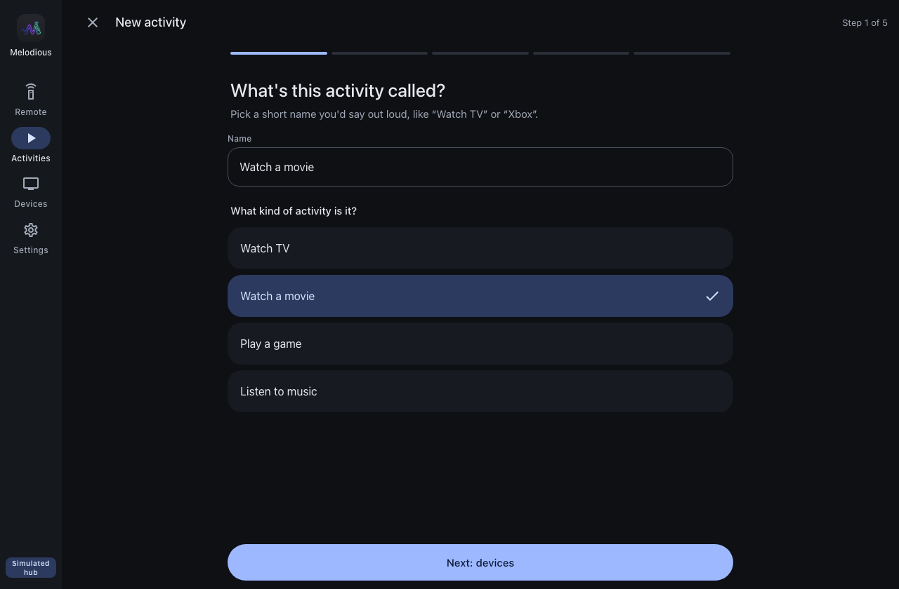

### Step 2: Pick devices and give each one a job

The heading is **Which device does what?** Check the suggested devices
rather than accepting the first TV or receiver automatically.

1. Tap the **Screen** row and choose the TV or projector.
2. Tap **Sound / volume** and choose the receiver, soundbar, or TV whose
   speakers you use.
3. Choose **Add another job → Plays movies & shows** for a streamer or
   Blu-ray player, then choose that device. A game or music player has its
   own **Plays games** or **Plays music & media** job.
4. Add **Changes channels** when a cable box/tuner supplies channels, and
   **Keyboard / typing** if you use a compatible typing device.
5. Check **Turning on** in Web/Desktop. New activities normally start the
   screen, then sound, then player. Use the **− / +** controls to adjust
   waits between devices. These are separate from each device's Warm-up
   time. Existing activities keep their saved order/waits.
6. Choose **Next: inputs**.

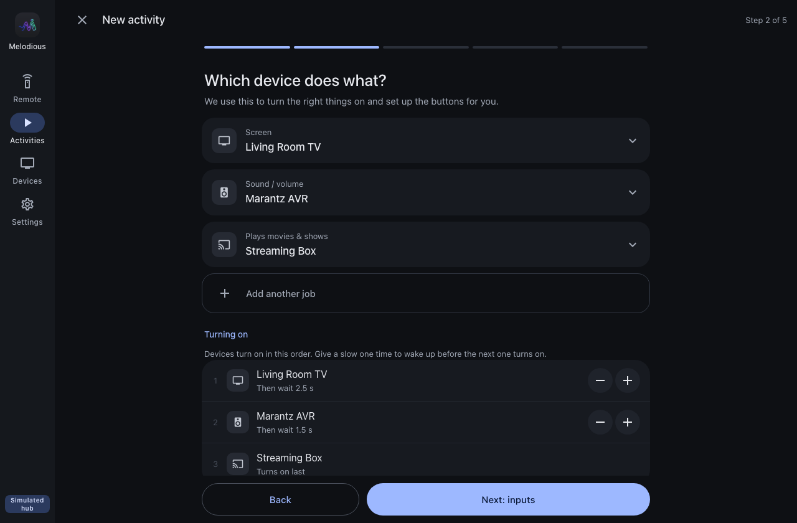

One device can have several jobs: a TV using its own speakers can be both
Screen and Sound / volume. A device is still powered only once.

| Job | What it helps assign |
| --- | --- |
| **Screen** | Picture device and its selected input; fallback for controls without a more specific job |
| **Sound / volume** | Volume up/down and mute |
| **Plays movies & shows**, **Plays games**, **Plays music & media** | Player navigation, menu/back and appropriate playback controls |
| **Changes channels** | Channel up/down and number buttons; explicitly check Guide because it may follow the player instead |
| **Keyboard / typing** | The device for keyboard entry |

These are suggestions based on the commands that actually exist. Check
the Buttons step: an unmapped key is not proof the role was saved wrongly.
It may simply need a different command name or an explicit assignment.

### Step 3: Choose every input in the signal path

1. On the TV card, choose the socket carrying the picture: **HDMI 2** in
   this example.
2. On the receiver card, choose the input carrying the streamer: **HDMI 2**
   in this example, not necessarily the same number in your room.
3. Choose **Don't switch** only when you deliberately want to leave that
   device's input unchanged. A player with no selectable inputs needs none.
4. Choose **Next: buttons** in Web/Desktop, or **Next: start & end** on Android.

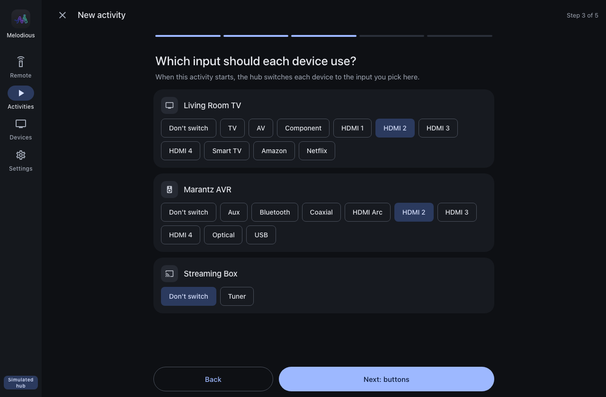

**Missing HDMI choices?** Stop and configure **Devices → your device →
settings → Inputs** in Web/Desktop. Merely importing `InputHdmi2` does not
necessarily create a named activity input. Return to the activity editor
after saving the device settings. See the
[device settings walkthrough](DEVICES_AND_CODES_GUIDE.md#do-not-skip-device-settings).

**Android's next step:** use **Start & end** to check power order and waits;
leave extra commands empty for your first activity. Then choose **Next:
buttons**. [Extra start/end steps](#power-order-and-extra-startend-steps)
below explains that screen.

### Step 4: Customize buttons, including Press and Hold

The heading is **Check the buttons**. Scroll through **Volume & channel**,
**Navigation**, **Playback**, **Colour keys**, and **Numbers**.
**Numbers** includes **Dash (–)** and **Enter (E)**, the `--` and `E` keys
either side of 0 on the Smart Control and Companion. The wizard never fills
these two in for you; pick what they send. Remotes with a screen don't have
them, so they stay off the Touch and Elite.

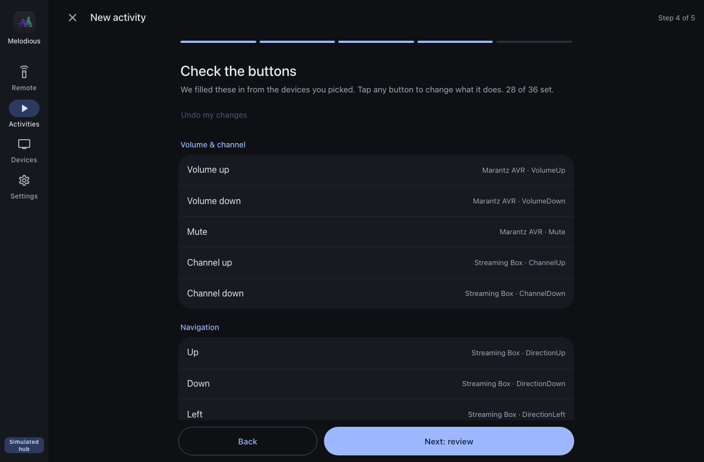

**Ordinary press, all platforms:**

1. Tap a button row, such as **Volume up**.
2. Choose the correct device chip, then the command. Use **Search commands**
   if the list is long. Volume should target your receiver, not your streamer.
3. Repeat for **OK**, arrows, Back, Menu, Guide, play/pause and any other
   controls you use. A row saying **Not set** needs an assignment only if
   you want to use it.
4. On Android, the wizard picker changes the ordinary press only. For
   custom holds and the other options below, use Web/Desktop, including
   the hub's Web UI on your Android phone.

**Different action on a hold, Web/Desktop:**

1. Open a mapped key, for example **Guide**. Set its **Press** action first.
2. Select the **Hold** tab, choose the device, and choose a different
   command such as the streamer's `Home`.
3. The picker closes after choosing a command. Reopen the row to check
   both assignments. This remains a draft until **Save activity**.

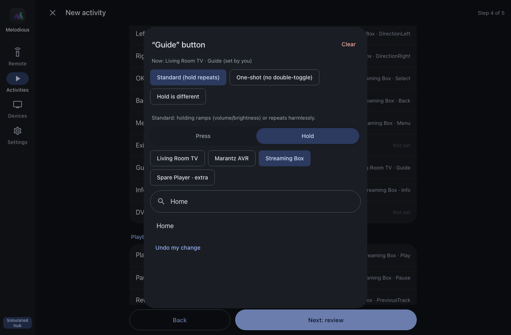

Choose press behavior deliberately:

- **Standard (hold repeats)** is useful for volume or brightness steps.
- **One-shot (no double-toggle)** sends a toggle once even when held; use
  it for commands such as Mute or PlayPause when repeating would undo them.
- A distinct **Hold** command gives a short action when you release early
  and a long action when held. **No hold action** removes a custom hold;
  do not confuse that with disabling normal repeat behavior.

The wizard covers **36 ordinary hard-key positions**, not every physical
button on every remote. In particular, **Power and activity shortcuts are
not among those 36 keys**. To change an activity shortcut's short/long
action, use **Settings → Remotes → Activity buttons** for that remote.
Do not try to turn the system Off button into an ordinary wizard key.

In Web/Desktop, a command from a device outside the activity is marked
**Extra**. It can control a lamp without making the activity power that
lamp on or off. Android's wizard picker lists the activity's devices.

The wizard picker assigns commands; it is not a test/send button.
Save first, then use the activity's **Try the buttons** or running remote
for live tests. Even Try the buttons sends real commands; it does not
start the complete power/input recipe.

### Step 5: Review, save and try the whole activity

**Web/Desktop:** choose **Next: review**. Check **Name**, **Devices**
(including waits), **Inputs**, and **Buttons**. Click a summary row to
correct it, then return and click **Save activity**.

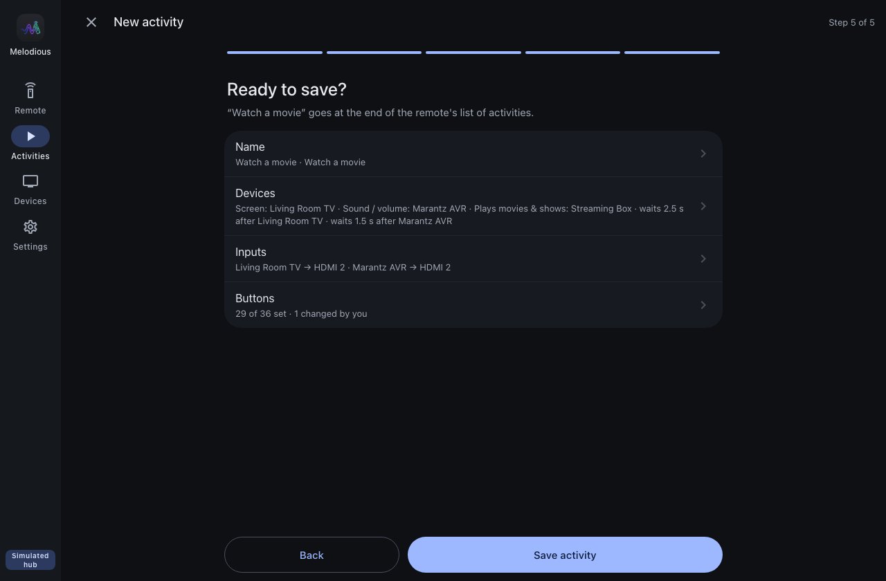

**Android:** there is no separate Review page. Check the earlier steps
with **Back**, then tap **Save activity** from **Buttons** (`Step 5 of 5`).

 Android Step 5 of 5: Check the buttons and Save activity

Wait for confirmation. A successful save publishes a new configuration
revision. Remotes with screens pick up the changed configuration
automatically; screenless remotes use the saved hub map immediately. A
save confirmation is not a guarantee that a sleeping screen remote has
finished syncing yet.

Now test in the room:

1. Begin with devices off, except those intentionally always on.
2. In **Activities**, choose **Start** next to the new activity.
3. Wait through startup without pressing extra keys. Check picture, sound
   and both the TV and receiver inputs.
4. Test volume/mute, arrows/OK/Back, playback, numbers if needed, and each
   custom short/long press, using both the app and physical remote.
5. Switch to another activity sharing the TV/receiver, then back. Check
   that shared devices stay on and the right inputs change.
6. Use **Turn off** and check the expected devices turn off.

If the hub refuses a save because something changed elsewhere, reopen the
latest activity and reapply the edit. Do not keep saving an old editor
over work made from another app. Avoid simultaneous edits while learning.

> **Milestone — your basic activity is complete!**
> Once that room test passes, your activity is ready for everyday use (take a quick backup in Web/Desktop's **Settings → Backup**). If a device missed power or an input during testing, jump straight to **[Everyday troubleshooting](#everyday-troubleshooting)**.
>
> Everything between here and Troubleshooting is **optional customization** — skip it for now, or come back anytime for the specific feature you want:
> - **[On-screen buttons and gestures](#on-screen-buttons-and-gestures)** (screen remotes: Touch, Ultimate, Elite, 950)
> - **[Home control buttons and dimming](#home-control-buttons-and-dimming)** (Companion, Elite, 950)
> - **[Power order and extra start/end steps](#power-order-and-extra-startend-steps)** (custom startup/shutdown order or extra commands)
> - **[Time restrictions and paired remotes](#time-restrictions-and-paired-remotes)** (quiet hours, remote pairing, per-remote overrides)

---

## On-screen buttons and gestures

These are for remotes with screens: **Touch, Ultimate, Elite and 950**.
Hardware validation varies by model; see [Touch editor](TOUCH_EDITOR.md)
and [two-screen remotes](TWO_SCREEN_REMOTES.md). Screenless remotes do not
gain a touchscreen by adding these buttons.

### Add useful screen buttons

1. In Web/Desktop, open **Activities → your activity's ⋮ → On-screen
   buttons**. The running activity has a direct On-screen buttons icon.
2. Stay on **On-screen**, choose **Add a button**, pick a device/command,
   and give it a short label you will recognize, such as `Subtitles`.
3. Finish the picker with **Done**, arrange the rows with their move
   controls, and choose **Save to hub**.
4. Let the physical remote finish its automatic sync, then test the button.

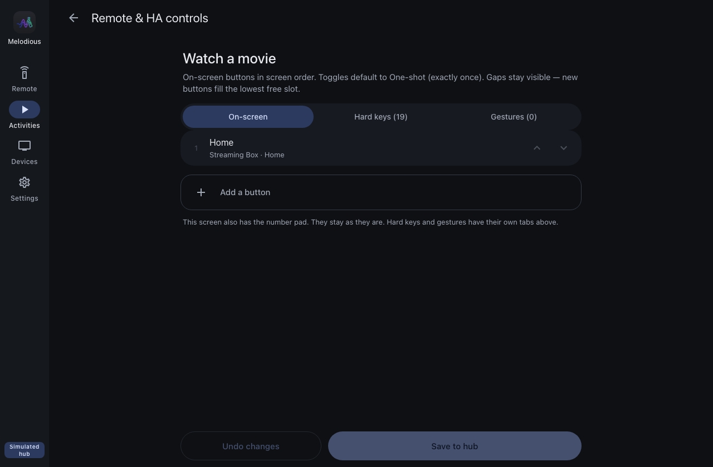

Buttons can also run sequences: several commands with waits between them.
Start with one command, then add a sequence only when you need it.
Choose **One-shot** for toggles, **Standard** for repeatable steps, or
**Separate Hold** for a distinct hold action.
On Android, open **On-screen buttons & sequences**, use **Add button** or
**New sequence**, and **Save**. It edits screen buttons/sequences, not
the web editor's Gestures tab.

**Number pad and long-press digits (such as LG webOS Quick Access):**
New activities automatically seed the remote's `123` number-pad screen
whenever any activity device has digit commands (`0`–`9`), even if a
streaming player without digits handles the main navigation keys. Because
the physical remote's `123` number-pad firmware sends single-tap `fire`
events only (never `press`/`hold`), holding a key on the `123` pad cannot
trigger a long-press. To hold a digit or trigger an LG Quick Access
shortcut (`1`–`9`) in Web, Desktop (Windows, Linux, macOS) or Android, add
an ordinary on-screen button instead:
- **Home Assistant (`ha-melodious`) or IR with a direct app/input command:**
  choose the digit (`1`–`9`) as the press command, select **Separate Hold**,
  and pick the target command (such as `App Netflix` or `Input HDMI 2`) as
  the hold command. A short tap sends the digit; holding ≥ 600 ms launches
  the app or input.
- **IR-controlled TV detecting a held digit directly:** choose the TV's
  digit command (`1`–`9`) with **Standard** press behavior so holding the
  on-screen button transmits a continuous IR hold to the TV.

### Swipes and taps on the physical remote

1. In Web/Desktop's On-screen buttons editor, select **Gestures**.
2. Edit an existing swipe/tap, or use **Add a gesture** for an unused one.
3. Choose the target device and command, finish the picker, and **Save to hub**.
4. Read any device-screen warnings and test on the physical remote after sync.

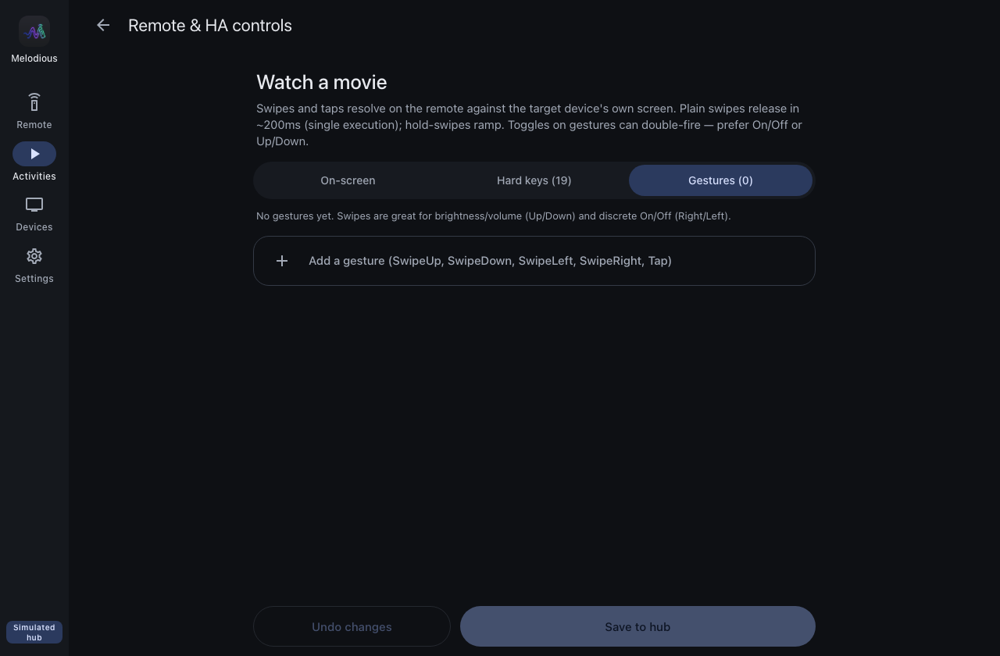

The remote resolves gestures against the target device's own screen.
That screen must contain the command; if the gesture resolves to a hard
key, that key must also be mapped in the activity. Use the editor's device
screen tools/warnings and [Touch editor](TOUCH_EDITOR.md) to check this.
Prefer separate On/Off or Up/Down commands; gestures cannot use the hub's
one-shot protection for toggles. Android's **Touchpad** mode is a phone
control surface, not this editor for physical-remote gestures.

## Home control buttons and dimming

For **Companion, Elite and 950**, use Web/Desktop or an Android browser:

1. Open **Settings → Remotes**. In the relevant remote's **Home control
   buttons** card, choose **Every activity** for global controls, or a
   specific activity for its own overrides.
2. Select a button. Companion uses **Light 1**, **Light 2**, **Plug 1** and
   **Plug 2**; the 950 uses physical-dot labels **• 1 dot** through
   **•••• 4 dots**. Follow what is printed on your remote.
3. On **Press**, choose a Home Assistant light/plug command, activity or
   sequence. Set **Long press** only after setting a press action.
4. On that button's **+** and **−** tabs, choose commands such as
   `BrightnessUp` and `BrightnessDown` for the same light.
5. Click **Done**, then **Save to hub**. Test the physical button, then +/−.

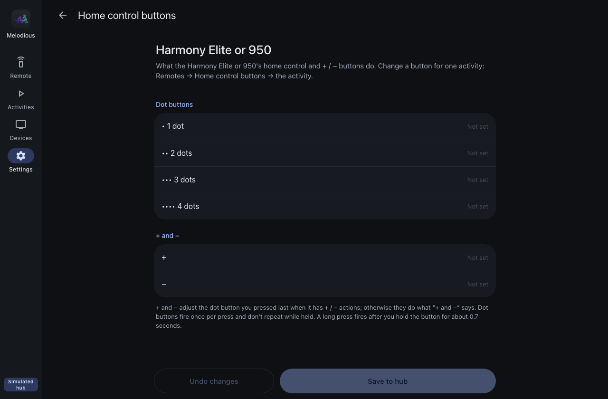

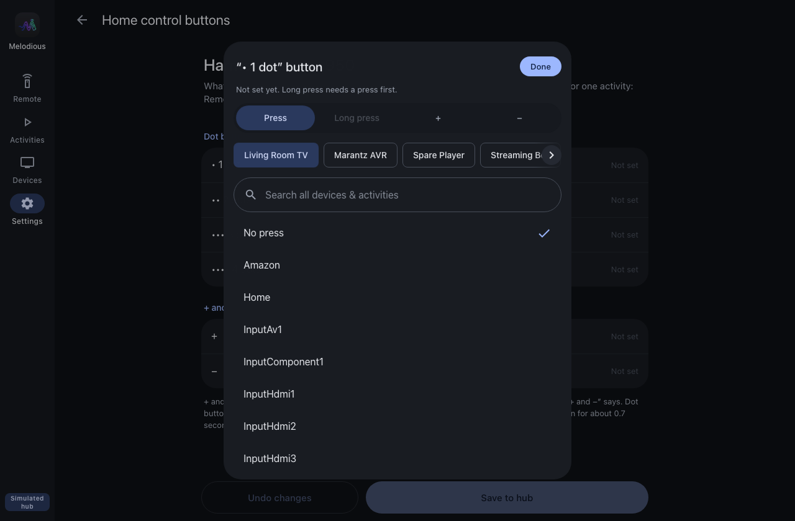

The rocker follows the last Home control button you pressed. Its own
standalone +/− rows are the fallback when that button has no dimming
assignment. An activity-specific setting overrides the whole global
button for that activity. **Same as global** follows the global setting;
**Nothing in this activity** deliberately disables it there.

The native Android app has no Home control editor. A missing card can
mean that remote is not paired or has not synced maps with the hub yet.
For model-specific behavior and tested limits (including 950 long-press
and per-activity caveats), see [Home control buttons](HOME_CONTROL_BUTTONS.md).

## Power order and extra start/end steps

Make a backup in Web/Desktop's **Settings → Backup** first. Power/input
commands already belong to the device's power/input recipe: do not add
another PowerToggle as an "extra" or you may turn it off again. For native
network TVs such as [Android TV](ANDROID_TV.md) or [LG webOS TV](WEBOS_TV.md) (experimental),
configure the TV's MAC address for Wake-on-LAN `PowerOn` when using discrete
power. For wake-only devices such as a [Nintendo Switch 2](SWITCH2_WAKE.md), Power On
fires the BLE wake burst at activity start while Power Off is a no-op
(sleep is handled by TV HDMI-CEC standby or the console itself).

### Android: guided Start & end

Open the activity's editor and go to **Start and end** (`Step 4 of 5`, reached via **Next: start & end**):

 Android Step 4 of 5: guided Start and end

1. Under **Turn on in this order**, move devices with the up/down arrows.
   Adjust **then wait** with −/+, for example to let a slow receiver wake
   before starting the streamer.
2. Keep **Turn off in the same order**, or turn it off to choose a separate
   **Turn off in this order** shutdown sequence.
3. Under **When this activity starts**, use **+ Command** for an extra
   non-power/input command (such as a sound mode) and **+ Wait** for a delay.
   These extras run **after** devices are on and on the right inputs.
4. Under **When this activity ends**, add extras that must run **before**
   devices turn off. Put each wait next to the command that needs it.
5. Tap **Next: buttons**, then **Save activity**, and test a complete start/end.

### Web/Desktop: Advanced editor

1. Open **Activities → your activity's ⋮ → Advanced editor**, then select
   the activity in the ordered list.
2. In **Devices & inputs**, find its device roles. Set **Power on order**,
   **Power off order**, and **Delay after power on (ms)**. These are the
   activity's order and inter-device waits; **1,000 ms = 1 second**.
3. For separate remote maps, select **Remote buttons**, then **Remote
   surface**. Prefer **Settings → Remotes** for guided per-remote key edits;
   the advanced editor exposes raw surface-specific assignments.
4. For extra start/end commands, **Advanced JSON** exposes the **Selected
   Activity object**, including its entry/leave actions. There is **no
   guided Add command start/end list in this web editor**. Prefer Android's
   Start & end step if you are not comfortable with the activity schema.
   Do not invent device/function IDs or replace a whole object with an
   example from another hub.
5. If editing JSON, use **Apply JSON to working copy**, inspect the result,
   then **Save to hub** or **Save & refresh remote**. Applying JSON alone
   does not save it. Keep the backup until you have tested both start and end.

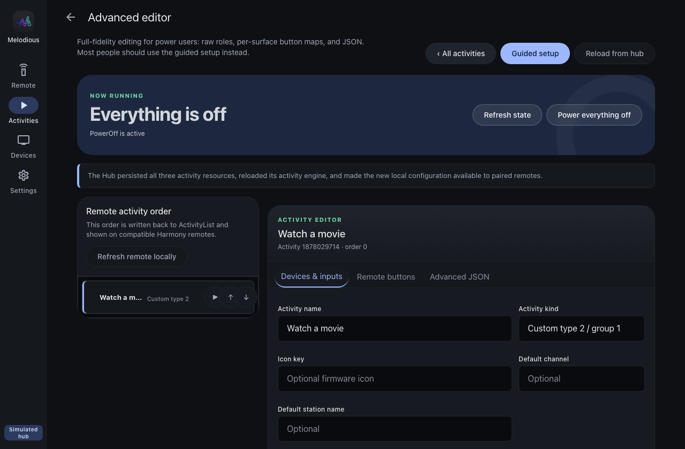

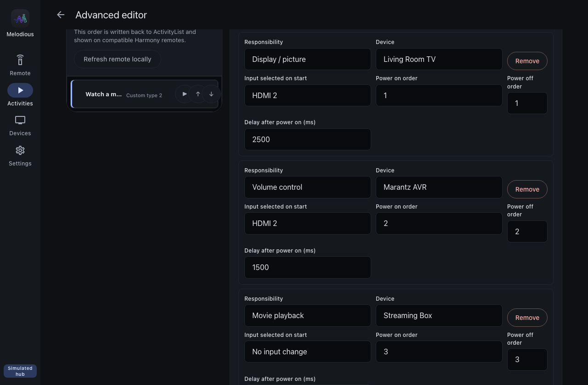

## Time restrictions and paired remotes

### Prevent accidental late-night starts

In Web/Desktop, use **Activities → ⋮ → Time restrictions → Add a time**.
Choose days, **From** and **Until**, then **Save**. These are times the
activity **cannot start**, not allowed hours, and they apply to all remotes
and apps using the hub's time zone. An activity already running is not
stopped when a restriction begins. For a scheduled shutdown, Android has
a **Sleep timer**; restrictions are not a substitute for one.

### Pair and customize remotes

Open **Settings → Remotes** in Web/Desktop. Choose **Open pairing window**,
then put the physical remote into its model's pairing mode. For Smart
Control, hold **Menu + Mute** for about five seconds. Do not apply that
button combination to every model; follow the page's instructions.

#### Moving a remote with a screen to a new hub

A Touch, Elite, Ultimate or 950 remembers the hub it was set up with. On a new
hub it shows **Unable to reach hub** and doesn't pair: it keeps looking for
the old one. These steps got a Harmony Elite (remote firmware 4.15.330) that
had been set up on another hub paired and synced on a Melodious hub:

1. Factory-reset the remote. On the Elite, hold **Off** and **Menu** together
   for about 20 seconds. It comes back on **Set up remote using Harmony app**,
   and its buttons do nothing. **This erases the setup stored on the remote**;
   the hub keeps its own copy.
2. Restart it: hold **Off** for about 15 seconds, until it reboots.
3. Open the pairing window in **Settings → Remotes** and hold **Menu + Mute**
   on the remote, near the hub.
4. It pairs, then pulls the hub's activities, devices and button maps on its
   own.

Don't skip step 2. Right after a factory reset the remote either doesn't
answer the pairing window, or it pairs and then stays on **Set up remote using
Harmony app**, asking the hub only for its provisioning info. Putting it on
its cradle doesn't help; the 15-second restart does, and the sync starts. This
happened the same way with the hub's minimal `Settings` and `CapabilityList`
and with copies from a hub set up by Logitech, so those resources aren't what
the remote waits for.

Each paired remote has activity/button editing entries. Use **Activity
buttons** for a screenless remote's activity shortcuts, and the relevant
activity's key editor for ordinary keys. Shared edits normally keep maps
alike; **Only this remote** makes a deliberate override. Existing
differences are shown so you do not overwrite them accidentally.

- [Multiple remotes of one model](MULTI_REMOTE.md): opt-in; same-model
  remotes share a button setup, not independent maps per physical unit.
- [Two remotes with screens](TWO_SCREEN_REMOTES.md): a separate opt-in
  feature with prerequisites and hardware coverage described in that guide.
- [Touch editor](TOUCH_EDITOR.md): map sharing, overrides and local sync.

## Everyday troubleshooting

### Something did not turn on or switch input: Fix it

1. Open **Remote** while the activity is running.
2. Tap the tool/wrench icon (**Fix it**).
3. Find the device that is wrong. **It's off** resends its On command;
   **Switch to HDMI …** resends the selected input. **Press power** is a
   toggle: use it only when the device's real state needs reversing.
4. Check the room after each correction. Fix it resends commands; it does
   not rewrite device settings or start a different activity.

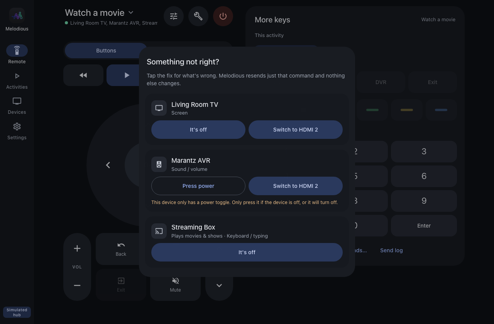

For all-discrete setups, Web/Desktop may offer **Resend power and inputs
for everything**. Android also has **Resend everything**; its state checks
avoid unnecessary resends where possible. With a toggle-only device,
prefer a targeted correction rather than repeatedly replaying startup.

### Picture missing, but selecting HDMI by hand works

Check both TV and receiver input choices. Raise the TV's **Warm-up time**
in device settings if the switch works once it has been on for a while
but fails from standby. Increase **Wait after switching input** if later
commands arrive too soon. For cycling inputs, verify the exact order and
**Input after power-on**. Test a cold start again after saving.

### Power is backwards

Use Fix it once, looking at the actual device. Then try to stop mixing
control methods that change power behind the hub's back. If you can find
and test separate `PowerOn`/`PowerOff` commands, choose **Separate On and
Off commands** in device settings. Renaming a toggle command does not
make it discrete.

### App changed, but the physical remote still has old buttons

Let a screen remote finish its automatic pull sync, near the hub and
**without a USB cable attached**. During sync, old labels may run newly
saved actions, so do not rapidly tap a moved screen button. If needed,
open **Advanced editor → Refresh remote locally** to republish the stored
configuration without changing it. Check pairing/connectivity if nothing
changes; see [local sync details](TOUCH_EDITOR.md#how-the-touch-gets-its-screens).

### A button does nothing only during this activity

Test the command directly from **Devices → Commands**. If that works,
check the activity's Buttons assignment, the target device, Press versus
Hold, and the physical remote's own map/override. A number or screen-only
command may be under **More keys** in the app rather than on the main pad.
For a gesture, also check its target device screen. A direct device test
working does not automatically create an activity mapping.

### One tap acts twice, or holding mute undoes itself

For double menu steps on a short tap, reduce device **Repeats** and retest.
For toggles that fire again while held, choose **One-shot** instead of
Standard. Keep volume/brightness on a repeatable setting if you want them
to ramp while held.

### Save fails or Start is refused

Wait for a clear save confirmation. If another client edited the setup,
reopen the latest version and retry your changes. If starting is refused
only at certain times, inspect **Time restrictions** and the hub's time
zone. Do not reset/reinstall the hub to solve a button map or timing issue.

When everything works, take a new backup and keep a note of the working
input choices. Your activity is ready for everyday use.
