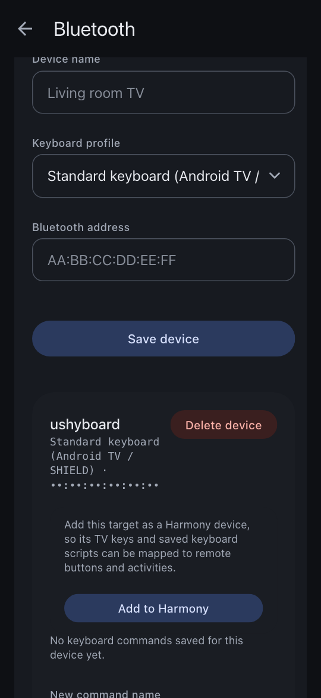

# Bluetooth keyboard

The hub pairs as a Bluetooth keyboard/remote with TVs, boxes (SHIELD, Google TV) and computers:
type from your phone, save keystroke scripts, map commands to any button — including Chromecast
with Google TV consumer keys (Home/Back `0x223`/`0x224`, Menu, Search, Guide, Info, Settings, Exit,
Voice, Quick settings).

This is different from [network TV pairing](ANDROID_TV.md) and from learning IR: an IR code cannot
reproduce a Bluetooth-only key, and learning cannot capture Bluetooth packets
([DEVICES_AND_CODES_GUIDE.md](DEVICES_AND_CODES_GUIDE.md)).

## Where to find it

- **Web app and desktop app:** **Settings → Bluetooth** — scan, connect, disconnect, adapter
  status, 30 quick keys and custom combos, and saved devices with keyboard-script commands
  ([MELODIOUS_WEB_UI.md](MELODIOUS_WEB_UI.md#web-only-the-app-lacks-these-they-stay-restyled)).
- **Android app:** **Settings → Bluetooth keyboard** for pairing and saved devices; the remote's
  keyboard surface (and voice dictation) types straight to the paired target
  ([Android/README.md](../Android/README.md)).
- **Remote → Keyboard** in the web app sends text and keys to the TV through the hub's Bluetooth
  keyboard.

Pair the hub with the target and test the keys before mapping them to buttons. A saved Bluetooth
device's commands then work like any other device command: in activities, on hard keys, on-screen
buttons, the number pad or gestures ([ACTIVITIES_GUIDE.md](ACTIVITIES_GUIDE.md)).

 Settings → Bluetooth: a saved device, ready for keyboard scripts

## Chromecast with Google TV and other consumer-page keys

Home and Back on a Chromecast with Google TV are consumer-page usages (`0x223` and `0x224`), not
keyboard keys. The hub sends them, plus Menu, Search, Guide, Info, Settings, Exit, Voice and Quick
settings, without re-pairing. The full name/usage table, which keys the Chromecast honours, and the
exact report bytes are in [API.md](API.md#consumer-page-tv-keys).

Verified on hardware: a Chromecast with Google TV (Bluetooth HID, including the consumer-page
Home/Back and TV keys) and a SEI Robotics Google TV box as a Bluetooth HID keyboard/remote target
([COMPATIBILITY.md](COMPATIBILITY.md#hardware-tested-with-melodious)).

## For scripts

The HTTP routes (`/api/bt-text`, `/api/bt-call`, `/api/bt-saved-command`, `/api/bt-text-status`)
and the `codex_bthid_keyboard` runtime are documented in [API.md](API.md).
