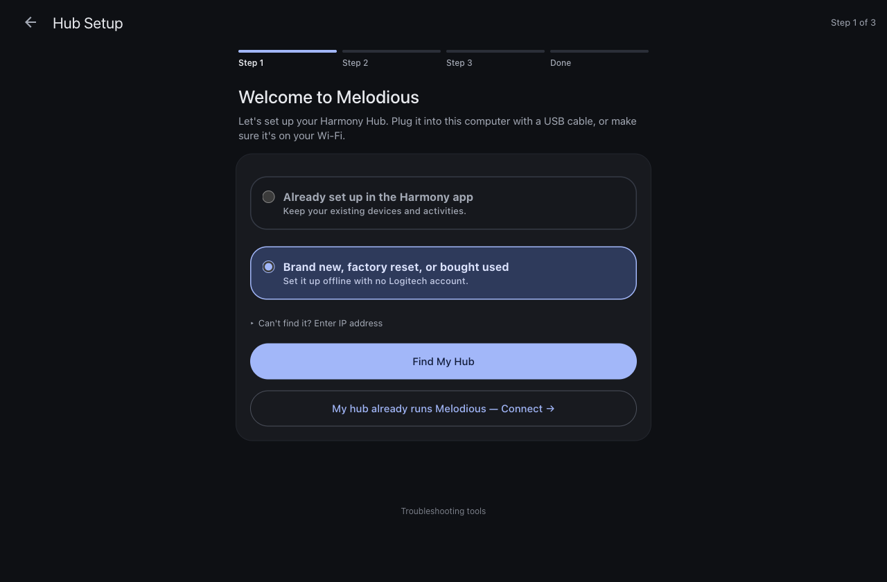
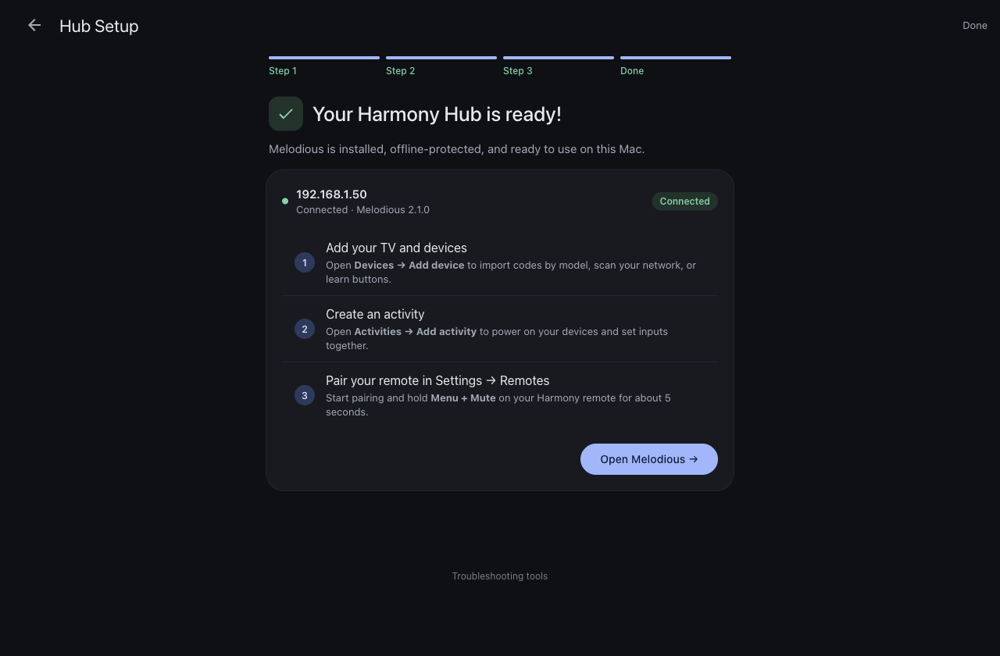
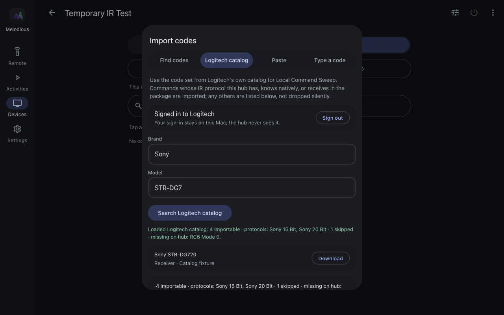
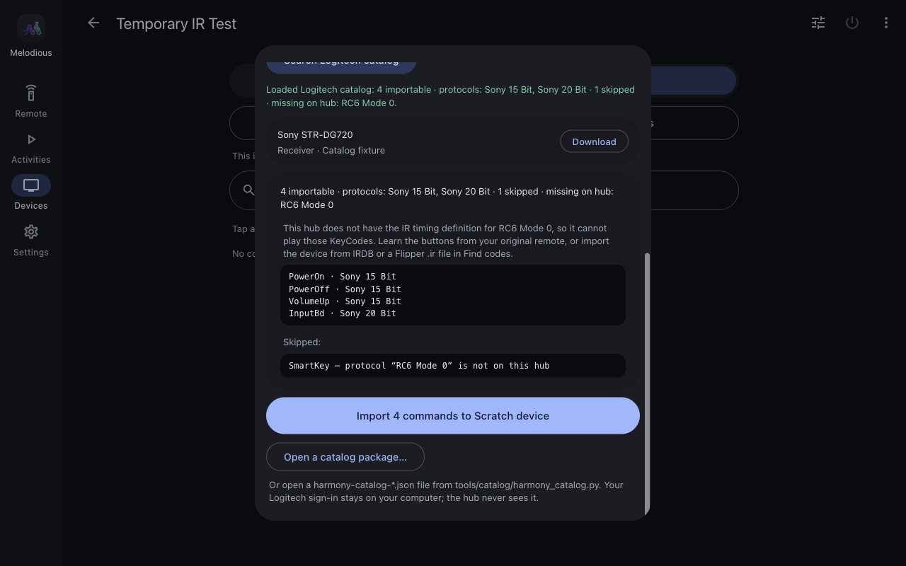

# Melodious desktop: setup and Logitech catalog lookup

Melodious runs on **macOS, Windows, and Linux**: the hub's web UI in a
desktop window, a guided hub setup, and Logitech catalog lookup (Windows and
Linux Desktop app and Setup Wizard: **Not fully tested, needs confirmation**).
Windows and macOS have desktop downloads; Linux runs from source. The built-in
Setup Wizard is on `main`, joining Windows and macOS releases in the first
release after `v2.1.0`. The bundled [CLI](../tools/hub-root/README.md) and
`install_webui.py` work on all three platforms now; Windows can also use
`install_webui.ps1`.

- **Same interface.** The window runs the packaged web shell unchanged:
  Remote, Activities, Devices and Settings, in the Melodious look. It talks
  to the hub over the LAN with the same routes as the web UI.
- **Catalog lookup.** In a device's Import codes sheet, the Logitech catalog
  tab gets Sign in, a brand and model search, a results list and Download.
  The downloaded package goes through the existing preview and
  `/api/catalog-import`. No Python helper, no terminal, no file to copy.
- **Setup Wizard.** Takes a hub from the Harmony app's setup, or
  from new, factory reset or second-hand, to rooted and running Melodious,
  over Wi-Fi or USB, with no commands. It's on `main` and ships in the
  first release after `v2.1.0`. The user guide, with a screenshot of every
  screen, is **[SETUP_GUIDE.md](SETUP_GUIDE.md)**.

## Install and first run (user guide)

- **Install:** choose your platform from the
  [release page](https://github.com/schlambos/harmony-hub-control/releases).
  - **Windows 10/11 x64 (Not fully tested, needs confirmation):**
    `Melodious-<version>-win-x64-setup.exe`, or extract
    `Melodious-<version>-win-x64.zip` and run `Melodious.exe`. The app is
    unsigned; SmartScreen may ask **More info → Run anyway**. Windows
    downloads start in the release after `v2.1.0`.
  - **macOS 13+ (Apple silicon or Intel):** `Melodious-<version>-arm64.dmg`
    or `Melodious-<version>-x64.dmg`; drag Melodious to Applications.
    Control-click → Open, or System Settings → Privacy & Security → Open
    Anyway. Choose **Allow** for local-network access.
  - **Linux (Not fully tested, needs confirmation):** [run from source](../desktop/README.md#linux-from-source).
    Python, USB dependencies, OpenSSH and `unzip` must be installed; no
    Linux desktop download is published. Don't run Electron as root.
- **First run.** With no hub saved, the app opens the Setup Wizard's Welcome screen
  ([SETUP_GUIDE.md](SETUP_GUIDE.md)); **My hub already runs Melodious —
  Connect →** goes to the connect screen, which looks for the hub with
  SSDP or takes a typed address. This applies to Windows, Linux and macOS.
- **Setup Wizard later.** File → **Set Up a New Harmony Hub…** on
  Windows/Linux, or Melodious → **Set Up a New Harmony Hub…** on macOS; the
  **Set up or re-root a hub** card in the **Hub setup** section below
  **Current hub** in Settings, or the
  **Set up a new or unrooted Harmony Hub** card on the connect screen.
- **Logitech catalog.** Open a device, then Import codes → Logitech
  catalog: (1) **Sign in** — Logitech's sign-in opens in its own
  window, and Google sign-in works too; (2) **Search** by brand and
  model, then pick a match; (3) **Download and import** — the preview
  shows what will import and why anything is skipped, and **Import**
  adds the rest. Your Logitech tokens stay in the app's background
  process, using the operating system's secure storage when available; the web page, the hub and the
  logs never see them. The app has no telemetry. Without the app, the
  same tab opens a package made with
  `tools/catalog/harmony_catalog.py` (see
  [its README](../tools/catalog/README.md)).
- **Update hub…** and **Reinstall / repair hub software…** over SSH are
  described in [INSTALL.md](INSTALL.md#updating).

Limits:
- Reuse, don't rewrite: the UI is the existing bundle, built by
  `tools/package_harmony_shell.sh`. It isn't ported to Swift or React.
- The hub doesn't change: no new routes, no C changes. Changes to the shared web
  code rebuild `codex_webui`, as every shell change does.
- No new system components: no URL scheme registration
  (`setAsDefaultProtocolClient`, `CFBundleURLTypes`), no helper apps, no
  login items, no auto-updater.
- The web UI keeps IRDB search, Learn, Paste and "Open a catalog package…"
  as offline fallbacks.

## Architecture

```
┌──────────────────────── Melodious desktop (Electron) ────────────────────┐
│ main process (Node)                                                      │
│  ├─ melodious://app scheme (protocol.handle)                             │
│  │    /, /index.html, /assets/harmony-shell.{js,css},                    │
│  │    /assets/activity-ui.{js,css}  → files inside the app               │
│  │    every other path              → http://<hub>:8080<path>            │
│  │                                    (+ saved Basic auth)               │
│  ├─ settings  (hub host and port, client_id override)  settings.json    │
│  ├─ secrets   (hub password, Logitech tokens)          safeStorage      │
│  ├─ discovery (SSDP M-SEARCH, then probe /api/system-status)            │
│  ├─ catalog   (OIDC + PKCE, Harmony signin, discovery, search,          │
│  │             download; port of tools/catalog/harmony_catalog.py)      │
│  └─ sign-in window (in-memory session; catches the app-scheme redirect) │
│ preload (contextIsolation on, nodeIntegration off, sandbox on)          │
│  └─ window.melodiousDesktop  (small, versioned bridge; no tokens)       │
│ renderer: the packaged web shell, unchanged except the catalog tab      │
└──────────────────────────────────────────────────────────────────────────┘
        │ LAN, plain HTTP (as the web UI)          │ HTTPS
        ▼                                          ▼
   codex_webui :8080 on the hub     accounts.logi.com, *.myharmony.com
```

### The window and the shell

- One main `BrowserWindow` loads `melodious://app/`. The scheme is
  registered with `protocol.registerSchemesAsPrivileged` as `standard`,
  `secure`, `supportFetchAPI`, `corsEnabled` and `stream`, so the shell's
  relative `fetch('/api/…')` calls, `cache: "no-store"` and uploads work as
  they do on the hub. No loopback port is opened.
- `protocol.handle('melodious', …)` serves the five bundle files from the
  app's resources, with the same `Content-Type` and `no-store` headers
  `codex_webui` sends. This is what the web UI's production-preview server
  does, with the hub in place of the simulator.
- Every other path is forwarded to the hub (next section).
- The page runs with `window.HARMONY_PRODUCTION=true`, exactly as on the
  hub. The shell can't tell the difference, except for the bridge.

Considered and not chosen: loading `http://<hub>:8080/` straight into the
window. That would put the bridge on an unauthenticated plain-HTTP origin
that anything on the LAN could pretend to be.

### Forwarding to the hub

- Target: `http://<host>:<port><path?query>`, with host and port from
  settings only. The path must start with `/`; absolute URLs, `//host`,
  backslashes and CR/LF are refused with 400 and never forwarded.
- Request headers sent: `Content-Type`, `Accept`, and `Authorization`.
  `Authorization` is the page's own header if it sent one (the System page's
  sign-in probes and lock checks send explicit Basic headers), and the saved
  hub credential otherwise. Nothing else is sent: no cookies, `Origin`,
  `Referer` or user agent from the page.
- The body is streamed for POSTs (uploads such as a restore or an update
  chunk). A request the page aborts is aborted toward the hub too.
- Timeouts: 10 s to connect; 120 s overall, because some routes take a
  while on the hub (inventory, activity runs, capture).
- Response headers passed on: `Content-Type`, `Content-Disposition`,
  `Cache-Control`. `WWW-Authenticate` and `Set-Cookie` are dropped.
- **401 from the hub** (when the page sent no `Authorization` of its own):
  the page gets the 401 as usual, and the app opens its "Sign in to the
  hub" sheet, as the Android connect screen does. After a save it reloads
  the window.
- An unreachable hub returns 502 to the page, so the shell shows its usual
  "not reachable" state, and the app offers the connect screen.
- Downloads (exports, backups, `download` links) go through Electron's
  `will-download` with a Save dialog. They are never saved without asking.
- The shell's IRDB fetches go from the page straight to `cdn.jsdelivr.net`
  on an explicit click, as on the hub. They are not forwarded; the CSP
  allows exactly those hosts (see "Security model").

### Connect screen and settings (desktop only)

The web UI has no connect screen, because the hub serves the page. The app
needs one, as the Android app does (`HubConnectScreen`). It's a small local
page (`desktop/src/connect/`) built from the shell's `tokens.css` and
`app.css` components (`.m-title`, `.m-list`, `.m-row`, `.m-field`, buttons),
so it looks like the rest of the app.

- **First run** opens the Setup Wizard, with a link to Connect for a hub
  that already runs Melodious. On later runs the app opens the
  shell for the saved hub, and the connect screen comes back when the hub
  can't be reached.
- **Find hubs:** SSDP `M-SEARCH` to `239.255.255.250:1900` with
  `ST: urn:myharmony-com:device:harmony:1` over Node `dgram`, as in
  `HubDiscovery.kt`. Each answer is checked with `GET /api/system-status` on
  port 8080 (a 200 or 401 is a Melodious hub; the firmware string is shown).
  The Android app's /24 port sweep is not ported.
- **Enter address:** host, plus a port that defaults to 8080, checked the
  same way.
- **Hub sign-in:** user name and password, only when the hub asks (401).
  Stored as a Basic header in `safeStorage`.
- **Settings** (File → Settings… on Windows/Linux, Melodious → Settings…
  on macOS): the hub (change or
  forget), the hub sign-in, Logitech account (signed in or not; Sign out),
  and an Advanced field for the OAuth client_id (empty means the built-in
  public one). The shared Settings tab doesn't change.

### Catalog client (main process)

A Node port of `tools/catalog/harmony_catalog.py`. Its callback check is
the strict one: the state is required and must match, the code is required, and bare strings and logi.com pages are
refused.

| Step | Call |
| --- | --- |
| PKCE | 48 random bytes → base64url verifier; S256 challenge; 24-byte state |
| Authorize | `accounts.logi.com/identity/oauth2/authorize`, `scope=openid`, `redirect_uri=com.logitech.harmony://lidsoauth` |
| Code exchange, refresh | `POST accounts.logi.com/identity/oauth2/token`, form-encoded |
| Harmony session | `POST lb-svcs…/Security.svc/json2/signin` with `{access_token,id_token}` and the bearer → `AccountId` |
| Operation table | `POST cf-svcs…/Discovery.svc/json/GetJsonOperations` `{"clientTypeId":"Redbull 1.0"}`, cached for the session; addresses moved to `lb-svcs` as the helper does |
| Model check (anonymous) | `GET svcs.myharmony.com/HarmonyPlatform/DeviceManager.svc/json2/SearchDevice/manf/<m>/model/<n>/iface/IR` → found or not, and the canonical spelling |
| Search | `DeviceManager/SearchGlobalDevices` (json2) `{manufacturer, modelNumber, deviceType:0, searchType:2, maxResults:50}` |
| Download | `GetGlobalDevices([id])`, then `GetGlobalLanguageCommands({globalLanguageVersionId:{Value}})` |
| Package | schema `0.2.0`, `source` names the desktop app, secrets redacted with the helper's `redact` rule |

Session handling follows `ensure_session`. It tries the saved tokens first,
then one silent refresh, and only then asks the user to sign in. A refused
catalog call ("Access is denied") gets one refresh-and-retry, never a loop.

Etiquette, as for the helper:
- Read-only. Nothing is created or changed in the Logitech account.
- One request at a time, one device per download, and nothing runs in the
  background or on a timer.
- Search and download run only when the user clicks.
- The model check runs on typing after a 600 ms pause, at most one request
  in flight, and never for the values pre-filled when the tab opens.

### The bridge

`desktop/src/preload.js` exposes one object through `contextBridge`:

```js
window.melodiousDesktop = {
  version: 1,
  catalog: {
    status(),                          // → { signedIn }
    signIn(),                          // opens the sign-in window → { signedIn: true }
    signOut(),                         // forgets the tokens → { signedIn: false }
    checkModel({ manufacturer, model }),  // anonymous → { found, manufacturer, model }
    search({ manufacturer, model }),   // → [{ id, manufacturer, model, displayText, deviceType, description }]
    download({ id, manufacturer, model }),  // → the 0.2.0 package, no credentials
  },
};
```

- Each call is an `ipcRenderer.invoke` on a fixed `catalog:*` channel.
- Main accepts it only from the main window's top frame at
  `melodious://app`.
- Arguments are checked in main: trimmed strings of 1–64 characters and an
  integer id. Anything else is refused.
- Nothing returned carries a token, the AccountId or a cookie.
- Errors come back as plain messages the tab can show, for example "Sign in
  to Logitech first", "Logitech refused the catalog session; sign in again",
  "No catalog device matches Sony STR-DG7".

## Screens

| Screen | Where it comes from |
| --- | --- |
| Remote, Activities, Devices, Settings and every sub-page | The packaged web shell, unchanged (`docs/MELODIOUS_WEB_UI.md`) |
| Connect: find hubs, enter address, hub sign-in | New desktop page, built from the shell's CSS components, after the Android `HubConnectScreen` |
| Setup Wizard: Welcome, Wi-Fi, Install, Done | Same cross-platform page, in wizard mode (`desktop/src/wizard/flow.js`); every screen is in [SETUP_GUIDE.md](SETUP_GUIDE.md), captured by `desktop/scripts/capture-oob-screenshots.mjs` |
| Desktop settings (File → Settings… or Melodious → Settings…) | Same page, in settings mode |
| Logitech sign-in | Logitech's own page in a separate window; it closes itself on success |
| Import codes → Logitech catalog | Shared tab: in the app it gains the account line, search, results and Download; on the hub it keeps "Open a catalog package…" |

<table>
<tr><td align="center"><br><sub>Setup Wizard: choose your hub's path</sub></td><td align="center"><br><sub>Setup Wizard: hub ready</sub></td></tr>
<tr><td align="center"><br><sub>Search and download</sub></td><td align="center"><br><sub>Preview, with skipped commands</sub></td></tr>
</table>

The catalog tab in the app, top to bottom:
1. Account line: "Signed in to Logitech" with Sign out, or a Sign in
   button.
2. Brand and Model fields, pre-filled from the device's manufacturer and
   model. Under Model, the check: "Logitech knows this as STR-DG720" or
   "Not found under that name".
3. **Search Logitech catalog**, then a results list: display text, device
   type and description, one row each. Tapping a row downloads it.
4. The existing preview: importable count, protocols, a command sample,
   and every skipped command with its reason (for example "protocol 'X' is
   not on this hub"). Then the existing **Import N commands to <device>**.
5. "Open a catalog package…" stays below, for packages made by the helper.

## Code reused

| Reused | From |
| --- | --- |
| The whole UI | `tools/webui-sim/public/` through `tools/package_harmony_shell.sh` → `tools/webui-sim/build/{index.html,harmony-shell.js,harmony-shell.css}` |
| The advanced editor | `tools/webui-sim/public/vendor/activity-ui.{js,css}` (byte-identical to `payload/web/`) |
| Serving the bundle and forwarding everything else | the production-preview server used for the web UI's screenshots (the model; rewritten as a `protocol.handle` handler) |
| Catalog preview and import | `js/logitech-catalog.js` (`catalogRows`, `hubProtocolNames`, `describeCatalogRows`), the catalog tab in `js/views/device-import.js`, `importCatalog` in `js/api.js`, the hub's `/api/catalog-import` |
| Catalog client | `tools/catalog/harmony_catalog.py`, ported to Node, with the strict callback check |
| Discovery | `Android/core-protocol/.../discovery/HubDiscovery.kt` (SSDP payload, `/api/system-status` probe) |
| Hub sign-in | `Android/.../ui/settings/HubConnectScreen.kt` (`basicAuthHeader`) |
| Look of the connect page | `css/tokens.css`, `css/app.css` |
| Icon | the existing Melodious icon PNGs (an `.icns` is made from them at build time) |

## New code (`desktop/`, next to `Android/`)

```
desktop/
  package.json, package-lock.json   Electron and electron-builder pinned to exact versions
  electron-builder.yml              Windows x64 installer/zip; macOS arm64/x64 zip/dmg
  scripts/stage-wizard-runtime*.sh   SHA-256-verified Python + platform USB backend
  scripts/bundle-shell.sh           runs the packager, copies the bundle into build/shell/,
                                    fails if payload/source/harmony_shell_assets.h changed
  src/main.js                       app lifecycle, windows, menu, CSP, navigation locks
  src/scheme.js                     melodious:// handler: bundle files + forwarder
  src/settings.js                   settings.json + safeStorage secrets
  src/discovery.js                  SSDP + probe
  src/catalog/oauth.js              PKCE, authorize URL, parseCallback, exchange, refresh
  src/catalog/signin-window.js      the sign-in window and the redirect catch
  src/catalog/client.js             Harmony signin, operations, check, search, download, package
  src/ipc.js                        catalog:* handlers with argument checks and sender check
  src/preload.js                    the bridge
  src/connect/                      connect and settings page (HTML, a little JS, the shell CSS)
  test/                             node --test units + Playwright Electron end-to-end
  README.md                         build, run, test, release (short; the user guide is in the main README)
```

`desktop/node_modules/`, `desktop/build/` and `desktop/dist/` are ignored. No
bundle copy, catalog package or token is ever committed.

## Security model

**Renderer (the shell):**
- `contextIsolation: true`, `nodeIntegration: false`, `sandbox: true`,
  `webSecurity: true`. No `remote` module.
- CSP, set by the scheme handler on `index.html`:
  `default-src 'none'; script-src 'self' 'sha256-<the page's one inline script>'; style-src 'self' 'unsafe-inline'; img-src 'self' data:; connect-src 'self' https://cdn.jsdelivr.net https://data.jsdelivr.com; form-action 'self'; base-uri 'none'; frame-src 'none'; object-src 'none'`.
  - The hash is worked out from the bundled page at startup.
  - `'unsafe-inline'` for styles is needed: the shell and the vendored
    editor use `style=` attributes.
  - `connect-src` is the IRDB allowlist the smoke test already polices.
- Navigation is locked to `melodious://app`. Any other top-level
  navigation is cancelled. `window.open` and `target=_blank` links open
  in the default browser only if they are `https:`; everything else is
  denied.
- Permission requests (camera, microphone, notifications, geolocation,
  HID, serial, USB and so on) are all denied by `setPermissionRequestHandler`
  and `setPermissionCheckHandler`.
- No devtools in release builds, unless the user asks for them from the
  menu (View → Developer Tools), for debugging.

**Sign-in window:**
- Its own in-memory session (`partition: 'logitech-signin'`, not
  persisted), so Logitech and Google cookies never reach the disk or the
  shell. Each full sign-in starts clean; refresh tokens keep the user
  signed in between them.
- `sandbox`, no preload, no bridge.
- It may navigate only to `https:`. Popups are allowed only to `https:`, in
  the same session (Google login needs them), and are closed with the
  window.
- The callback is caught by `will-redirect`, `will-navigate`,
  `will-frame-navigate` and `onBeforeRedirect`. The first valid one wins.
  The state must match, and the window closes.

**Secrets:**
- Logitech tokens (access, id and refresh) and the hub password use Electron
  `safeStorage`: Windows DPAPI, macOS login Keychain, or the Linux desktop's
  available secret store. Linux storage depends on the desktop environment;
  don't assume the same protection without a working secret service.
  Files request mode 600 (Windows uses account ACLs) in Electron's per-user
  app-data folder: `%APPDATA%/Melodious/`,
  `~/Library/Application Support/Melodious/`, or `$XDG_CONFIG_HOME/Melodious/`
  (normally `~/.config/Melodious/`) respectively.
- If `safeStorage` isn't available, nothing secret is stored: tokens last
  only while the app runs.
- With ad-hoc signing, macOS may ask again for Keychain access after an
  update (the signature changes with each build). If access is refused,
  the user just signs in again.
- Tokens stay in the main process. They never reach the renderer, the
  hub, logs, packages or crash reports. Sign out deletes them.
- Nothing personal is built in: no account, email, hub address, hub ID or
  token. The only fixed value is Logitech's public desktop client_id
  (`9d88df5e…`), which Settings → Advanced overrides (the
  `MELODIOUS_CLIENT_ID` environment variable also works, as for the
  helper).

**What reaches the hub:**
- Exactly what the web UI sends today, plus the saved Basic header.
- The hub never sees Logitech tokens. It gets only the import body
  (`deviceId` and the command rows) from `/api/catalog-import`.

**What reaches Logitech:**
- The sign-in, Harmony signin, discovery, model check, search and the one
  device downloaded.
- Nothing about the hub: no hub id, address, device list or codes.

**Background traffic:**
- No telemetry and no crash upload.
- Update checks happen only if you choose "Check daily" (asked once) or
  click Check now / File → Check for Updates… (Windows/Linux) or
  Melodious → Check for Updates… (macOS). A check is one request
  to `api.github.com/repos/schlambos/harmony-hub-control/releases`, which
  shows GitHub your IP address and the app's version, plus
  `GET /api/version` on your hub. Nothing downloads until you choose
  an update. On macOS, Install and Restart fetches the matching zip and
  `SHA256SUMS.txt` from that release (redirects only within GitHub).
  Windows opens the release page for a new installer; Linux source users
  update their checkout. Turn checks off in Settings → Updates.
- **Update hub…** (Settings → Updates, when a newer hub release is out)
  downloads `melodious-hub-<v>.zip` and `SHA256SUMS.txt` from that release.
  It then talks to your hub over SSH with `~/.ssh/harmony_owner_*`, the
  installer's key, using your `~/.ssh/known_hosts`. Nothing about the update
  goes anywhere but GitHub and your hub.
- **Reinstall / repair hub software…** (Settings → Updates and the menu,
  whatever version the hub runs) does the same from a source you pick: the
  latest GitHub release, downloaded and checked the same way, or a
  `melodious-hub-<v>.zip` on this computer, which is read locally and
  downloads nothing.
- Otherwise the app makes no network request on its own except the SSDP
  search when the connect screen opens, and `/api/system-status` checks of
  hubs that answer it.

## Packaging and release

- **Windows:** `npm run dist:win` stages the shell and official CPython
  3.12.10 embeddable x64 runtime, SHA-256-verified from python.org, then
  builds the unsigned per-user installer and zip. `winhid` uses stdlib
  `ctypes`; no host Python, pip or HID wheel is required. Windows' OpenSSH
  Client (`ssh.exe`, `ssh-keygen.exe`) must be enabled. CI runs source and
  packaged E2E tests, including native USB enumeration without a hub.
- **macOS:** `npm run dist` stages the same shell plus relocatable CPython
  and `hidapi` for arm64 and x64, then builds separate zip/dmg files.
  Nested Mach-O files and the app are ad-hoc signed; no Developer ID or
  notarisation. `npm run test:dist` verifies both architectures.
- Both packages put `wizard-python`, `hub-root`, the installer script and
  required payload helpers outside `app.asar`. Upstream runtime licences
  are retained. Resources exclude venvs, tests, caches and Hub ID handoffs.
- **Linux:** source only, with Python/USB dependencies, OpenSSH and `unzip`
  supplied by the user. `npm start` runs the same wizard; no Linux runtime
  or desktop release artifact is bundled.
- Build, test and prerequisite details: [`desktop/README.md`](../desktop/README.md).
  Shell staging checks that the committed shell header hasn't changed.
- The owner publishes releases with the platform downloads and SHA-256
  checksums on the same commit as the hub build. No automatic publishing.
- **Hub and app versions:** the app's bundle matches the hub software from
  the same commit. An older hub without a route the bundle uses answers
  404. The catalog import then says "Your hub's Melodious software is older
  than this app; update the hub", instead of a bare error.
- **Electron updates** come only with new app releases. Each release pins
  the current Electron stable and says which version it ships.
