# Adding Devices & Importing IR Codes

Finished [setting up Melodious](SETUP_GUIDE.md)? Start here to add your TV,
receiver and players, get their buttons working, and tell activities how
to turn them on and select an input. **Importing codes alone is not enough:**
finish the power, input and timing settings before making an activity.

This guide covers the **Desktop app on Windows, Linux and macOS**, the
**Web UI in a browser on any of those systems or Android**, and the
**native Android app**. Click and tap mean the same thing here.

The screenshots are simulated examples, not a connection to a real hub.
Names, models and addresses are placeholders; use your own equipment's
details. A simulated successful send is not a hardware compatibility test.

## Contents

- [Before you start: choose the right device type](#before-you-start-choose-the-right-device-type)
- [Add an IR device](#add-an-ir-device)
- [Method 1: Logitech's catalog](#method-1-logitechs-catalog)
- [Method 2: other sources and learning](#method-2-other-sources-and-learning)
- [Test commands safely](#test-commands-safely)
- [Do not skip: device settings](#do-not-skip-device-settings)
- [Ready for activities?](#ready-for-activities)

## Before you start: choose the right device type

Have the original remotes nearby, write down each device's brand and full
model number, and note where every HDMI cable goes. Put the hub or its IR
mini-blaster where the equipment can see its signal. Make a backup before
large changes: **Settings → Backup** in Web/Desktop.

| What you want to control | Start here |
| --- | --- |
| An ordinary IR TV, receiver, soundbar, cable box or Blu-ray player | Add an IR device below, then import or learn commands. An IR code cannot reproduce a Bluetooth-only key. |
| An Android / Google TV over your network | In Web/Desktop choose **Devices → + → Android or Google TV on the network**. Follow [Android TV setup](ANDROID_TV.md) for pairing, standby/wake behavior and input setup. Do not import IR codes into its network command set. |
| A TV, streamer or computer that accepts a Bluetooth keyboard/remote | Use **Settings → Bluetooth keyboard** in Android, or **Settings → Bluetooth** in Web/Desktop. Pair the hub with the target and test the keys; see [Bluetooth keyboard](../README.md#bluetooth-keyboard). This is different from network TV pairing and from learning IR. |
| A light, plug, scene, network TV or receiver supplied by Home Assistant | Add it through the Melodious integration's **Configure** flow in Home Assistant, not as an empty IR device. See [Home Assistant](HOME_ASSISTANT.md). Its commands then appear alongside ordinary devices. |

### Where each tool lives

| Task | Desktop: Windows / Linux / macOS | Web UI, including an Android browser | Native Android app |
| --- | --- | --- | --- |
| Add an IR device or pair a network TV | Yes | Yes | Open the hub's Web UI to add it, then return to the app |
| Logitech sign-in, brand/model search, preview and import | Built in | Open a package downloaded with the helper | Built in |
| IRDB search, `.ir` files, RemoteCentral, **Type a code** | Yes | Yes | Use the Web UI for these paths |
| Paste codes; learn and test a button | Yes | Yes | Yes |
| Power and timing settings | Yes | Yes | Yes |
| Edit the input list and switching method | Yes | Yes | Use the Web UI |
| Scratch-device IR lab and dry-run sweep | Yes | Yes | Use the Web UI for the scratch device/dry run; the app also has an IR sweep under **Settings → Advanced** |

To open the Web UI, use `http://<hub address>:8080/` on the same network.
For example, `http://192.168.1.50:8080/` is an example address, not an address
to copy blindly. Windows, Linux and macOS share the same device screens.

## Add an IR device

1. Open **Devices** in Web/Desktop and click **+** (its accessible name is
   **Add a device**).
2. For IR, stay in **Add a device** rather than choosing the network TV row.
3. Enter a useful **Name**, such as `Living Room TV` or `Marantz AVR`.
4. Choose **Type**: for example **Television**, **Amplifier**, or **Media
   Player**. This helps the activity wizard suggest the right jobs later.
5. Enter **Manufacturer** and **Model** from the equipment label. The name
   you give it is not the model number used to search for codes.
6. Click **Add device**. This creates the device, not its IR commands.
7. Open the device, select **Commands**, then **Import codes**.

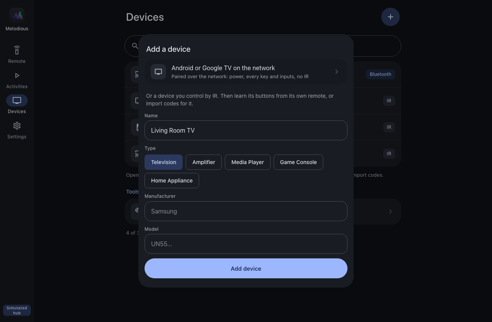

On Android, add the device in your phone's browser first. Return to the
Android app and reopen **Devices** once the hub's configuration has refreshed.
Both apps are editing the same hub, not separate copies of your setup.

## Method 1: Logitech's catalog

Try this first: Logitech often has a more complete model-specific set than
a learned remote, including separate On/Off and direct HDMI commands.
It needs internet access on your computer or phone and your own Logitech
account. Normal local control does not need that account afterwards.

### Desktop app on Windows, Linux or macOS

1. Open **Devices → your device → Commands → Import codes**.
2. Select the **Logitech catalog** tab.
3. Click **Sign in**. Use Logitech's sign-in window; Google sign-in is
   supported too. Complete the sign-in and return to Melodious.
4. Check **Brand** and **Model**. Search for the equipment's actual model,
   not the friendly name `Living Room TV`. Part of the model is enough.
   A model-check hint is useful, but is not proof that every key will work.
5. Click **Search Logitech catalog**. Check the model and device type in
   the results, then click **Download** on the best match.
6. Read the preview as described below. Downloading does **not** import.
7. Click **Import N commands to your device** when the preview looks right.
   Wait for the sheet to close and the import confirmation.
8. Reopen **Commands** and test the important commands individually.

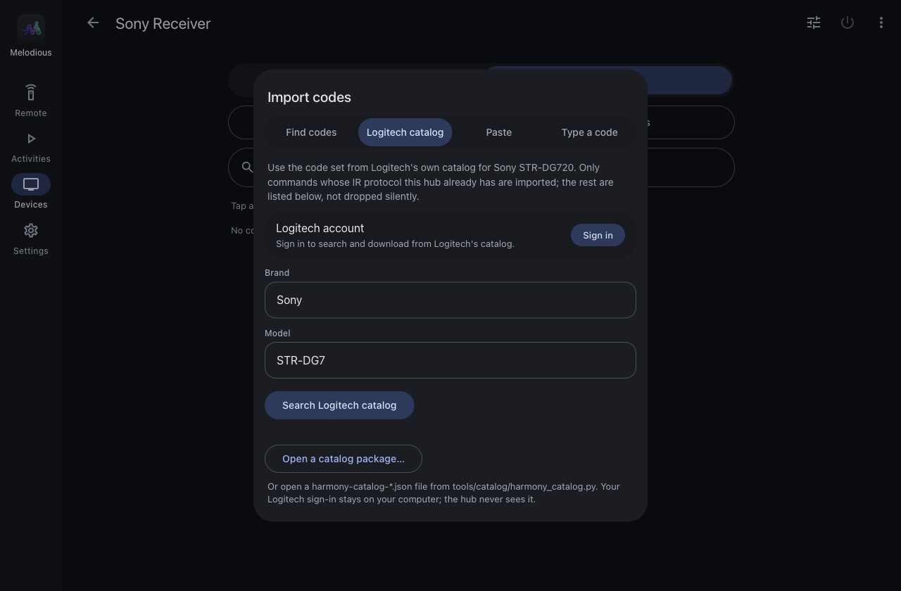

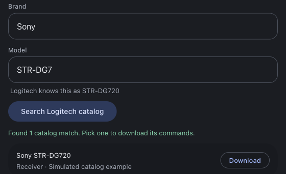

**Privacy:** sign-in goes to Logitech, not to your Harmony Hub. Sign-in
tokens stay in the Desktop app on your computer, using operating-system
secure storage when available. The hub receives command data, never your
Logitech password or tokens. See [Desktop app](DESKTOP_APP.md) for details.

### Android app

1. Open **Devices → your device → Commands → Import codes → Logitech catalog**.
2. Tap **Sign in**. Android opens Chrome's Auth Tab for Logitech sign-in;
   Google sign-in happens there too. Finish and return to Melodious.
3. Enter **Brand** and **Model**, tap **Search Logitech catalog**, and tap
   **Download** next to the right result.
4. Read the preview and skipped reasons, then tap **Import N commands to
   your device**. Test the imported commands from the device page.

Android keeps its tokens encrypted with the Android Keystore; they never
reach the hub. If sign-in says it needs Chrome, install/update a browser
with Auth Tab support, or use **Open a catalog package…** instead. See
[Android catalog](ANDROID_CATALOG.md) for the sign-in and storage details.

### Read the preview before importing

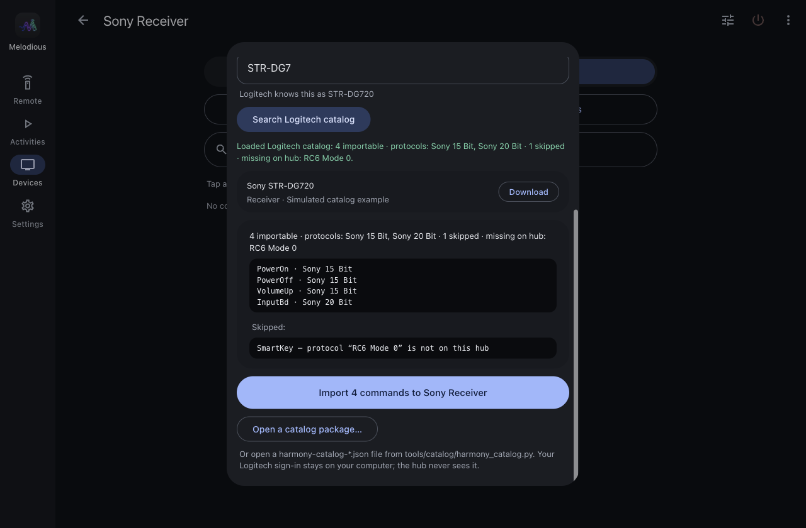

- **Importable** is the number this hub can accept, not the number the
  manufacturer claims the remote has. The preview shows a sample of the
  accepted names and lists skipped commands with reasons.
- A Bluetooth-only key is not an IR signal. An unsupported IR protocol or
  command without a usable IR code cannot be made to work by clicking
  Import again. Use a supported network/Bluetooth path or learn a real IR
  equivalent if the device has one.
- For dependable activities, look for `PowerOn`, `PowerOff`, and direct
  input commands such as `InputHdmi1` and `InputHdmi2`. Names vary by device.
  The preview lists only the first 24 accepted commands; verify the full
  **Commands** list after importing rather than assuming a command is missing.
- If only `PowerToggle` is available, you can still use it, but choose the
  toggle power setting later. If needed power/input commands were skipped,
  fill those gaps before relying on an activity.
- Import adds commands; existing names are skipped, not silently replaced.
  If a command already exists but is wrong, use its **⋮ → Edit** in
  Web/Desktop or learn a new, clearly named command and map that one.

### Browser-only alternative: open a catalog package

The Web UI can import a package but cannot sign in to Logitech directly.
On **Windows, Linux or macOS**, run the
[catalog helper](../tools/catalog/README.md) on your computer, for example:

```text
python tools/catalog/harmony_catalog.py Sony STR-DG720
```

Use your Python 3 launcher (`py -3` on Windows or `python3` on Linux/macOS
if needed). Follow the helper's sign-in instructions: sign in on Logitech's
page, then paste the resulting `com.logitech.harmony://…` redirect into
the helper's local bridge page or terminal. Never post that redirect or
your token file in an issue.

The helper writes a `harmony-catalog-*.json` package. Open your device's
**Import codes → Logitech catalog → Open a catalog package…**, select it,
review the accepted/skipped commands, and import. Android has the same
package picker. Only transfer the finished package, not
`~/.melodious/harmony_token.json`.

## Method 2: other sources and learning

Use these to fill gaps when the catalog is unavailable or incomplete.
You can combine sources on one device; test new commands before assigning
them to power or input settings.

### Find codes: IRDB search

1. In Web/Desktop, open **Import codes → Find codes**.
2. Enter **Manufacturer** and optionally **Model**, then **Search IRDB**.
3. Read the result descriptions. **IRDB groups sets by maker, device type
   and remote address, not exact retail model.** A close model search may
   return several sets, or no exact-model match at all.
4. Click **Preview** on a likely set. Prefer one with the power/input keys
   you need. Check the supported command count and any warnings.
5. Import the set to your device, or try it on an **IR lab** scratch device
   first. Test power and an input on the actual equipment before trusting it.
6. If nothing responds, try another likely set; do not keep increasing
   repeats on a completely wrong code set.

Search and preview fetch the library using your computer/phone's browser;
the hub does not fetch IRDB. Nothing is saved until you choose Import.

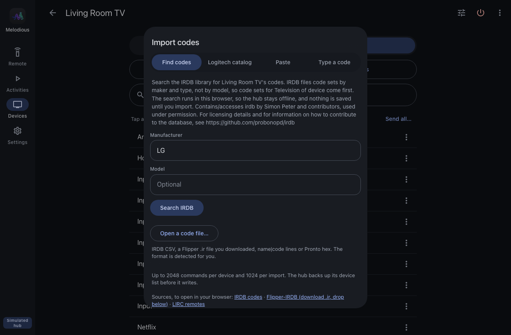

### Open a Flipper `.ir` file or IRDB CSV

1. Download a code file for equipment you own.
2. In Web/Desktop's **Find codes**, click **Open a code file…**.
3. Select the `.ir`, CSV or supported text file. The format is detected.
4. Read the preview and supported/skipped counts, then click the **Import**
   button with the command count. Test the new commands afterwards.

Not every Flipper protocol can be converted. A supported file format does
not guarantee that every entry in it has a usable signal.

### Paste: CSV, pipe-separated codes or Pronto hex

In Web/Desktop, select **Import codes → Paste**, paste your source text,
check the import count, then click **Import N commands**. Accepted sources
include IRDB CSV, `name|mode|code` lines and Pronto hex. For example, a
pipe-separated row has a command name, the mode (`raw` or `keycode`), and
the complete signal data; do not paste those explanatory words as a code.

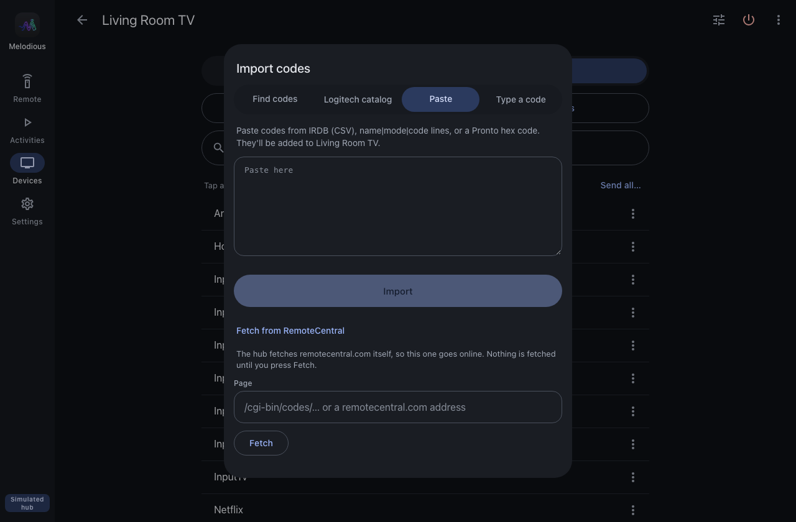

The Android app also has **Import codes → Paste** for CSV, pipe-separated
rows or Pronto input. For file-format detection and the detailed preview,
use the Web UI. Check its result before trying the imported commands.

**RemoteCentral (Web/Desktop):** under **Fetch from RemoteCentral**, enter
the code page's URL or `/cgi-bin/codes/…` path in **Page**, then **Fetch**.
This is an exception to the hub staying offline: **the hub itself fetches
that page**. Add the wanted decoded commands with **Add**, then import
from the paste box. If Fetch fails, nothing was imported; copy the Pronto
code from the page yourself and use Paste instead.

### Type a code

Use Web/Desktop's **Type a code** for one known signal:

1. Enter **Command name**, such as `InputHdmi2`.
2. Pick **Signal type**: **Auto**, **Keycode**, **NEC** or **Raw**.
3. Fill the matching **Keycode**, **NEC hex**, or **Raw timing** data.
   Use the **Protocol id** belonging to your signal; do not guess one from
   an unrelated device. Pronto hex belongs in **Paste**, not Raw timing.
4. Click **Add command**, then test it from **Commands**.

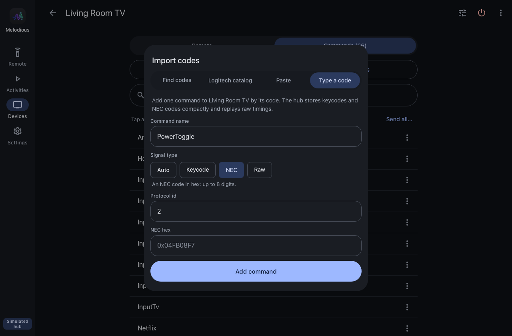

### Learn from the original remote

Available in Web/Desktop and Android:

1. Open the device's **Commands → Learn a button**.
2. Aim the original remote's IR emitter at the hub's front IR learning eye,
   starting about **5–10 cm (2–4 inches)** away. Use fresh batteries and
   avoid bright sunlight or other remotes transmitting nearby.
3. Choose **Start listening**, then tap the original remote's button
   cleanly. Start with a short tap rather than a long hold.
4. When the sheet shows **Got it**, enter a meaningful name in
   **Command name (e.g. InputHdmi3)**.
5. Click **Test** and watch the equipment. If it fails, learn it again;
   adjust distance/angle or try a slightly longer press.
6. Only after a successful test, click **Save to your device** (for example,
   **Save to Living Room TV**). Repeat for the next button.

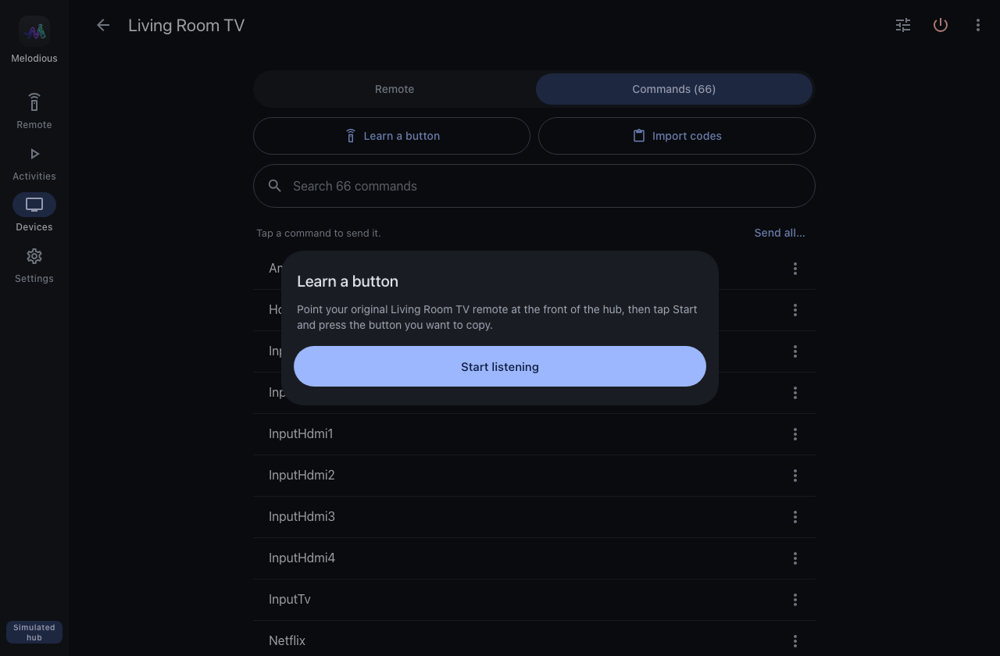

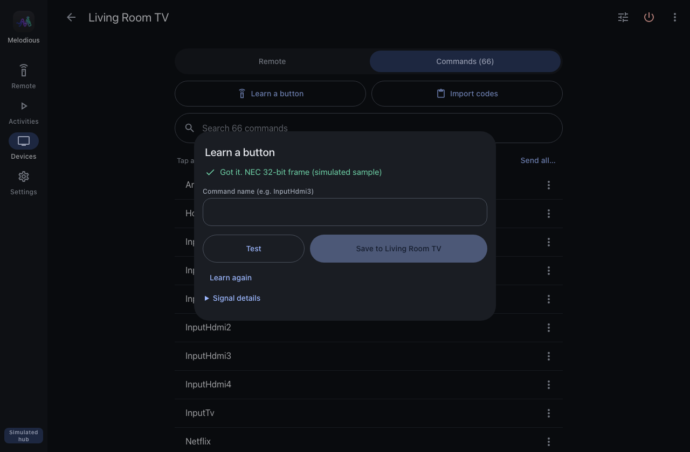

A Bluetooth remote's microphone/search key may send no IR at all. Learning
cannot capture Bluetooth or network packets. Also, learning a single
Power button usually gives you a toggle, not separate On and Off.

## Test commands safely

**Direct tests send real commands on a real hub**, even when no activity
is running. Turn the volume down, keep the equipment in sight, and avoid
unknown service/reset commands. IR usually gives no acknowledgement:
"sent" does not prove the TV received it.

1. Open **Devices → your device → Commands**. Tap one command to send it
   directly; use the search field to find power, volume and input names.
2. Also try the device's **Remote** tab. This isolates a device problem
   from an activity button-map problem.
3. Verify On and Off from both starting states. A genuine `PowerOn` should
   not turn an already-on device off. Verify each direct input lands on
   the intended HDMI socket.

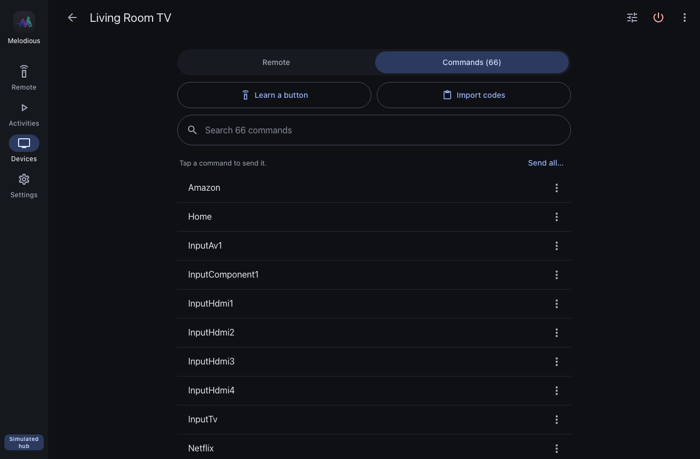

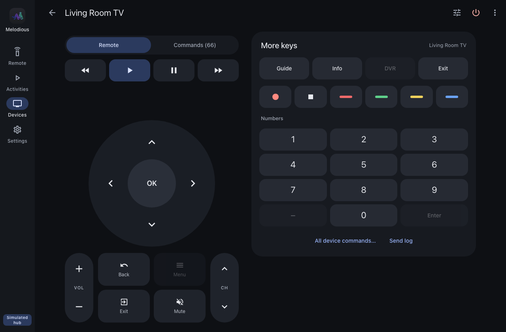

### Send all and IR lab (Web/Desktop)

**Send all…** on the Commands page opens **Send all commands**. Untick
anything unsafe, set **Gap between commands** generously, and run **Dry
run** first. It checks the batch without transmitting; it cannot tell you
which signals your TV accepts. **Send N commands** transmits the selected
commands. Watch the equipment and use **Stop sweep** to stop the rest.
It cannot undo commands already sent.

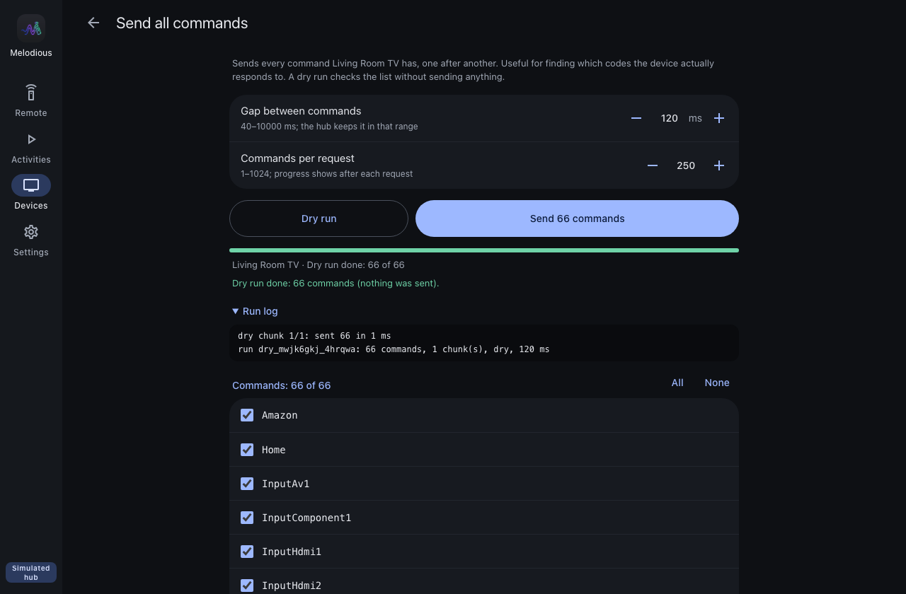

**Devices → IR lab → Set up the lab device** creates a scratch device.
Import or learn experimental commands there, test them individually or
with Send all, then copy the working source codes into your real device.
The scratch device is not isolated from the room: sending from it still
reaches any equipment that recognizes the signal. Leave it out of activities.

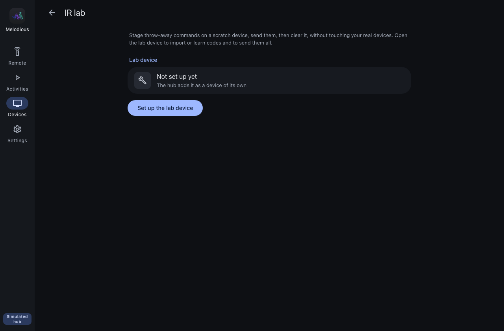

## Do not skip: device settings

Open **Devices → your device → the settings/sliders icon**. The page title
is the device's name followed by **settings**. Repeat this for every TV,
receiver and player. Importing commands does not automatically prove or
complete these settings.

### 1. Power control

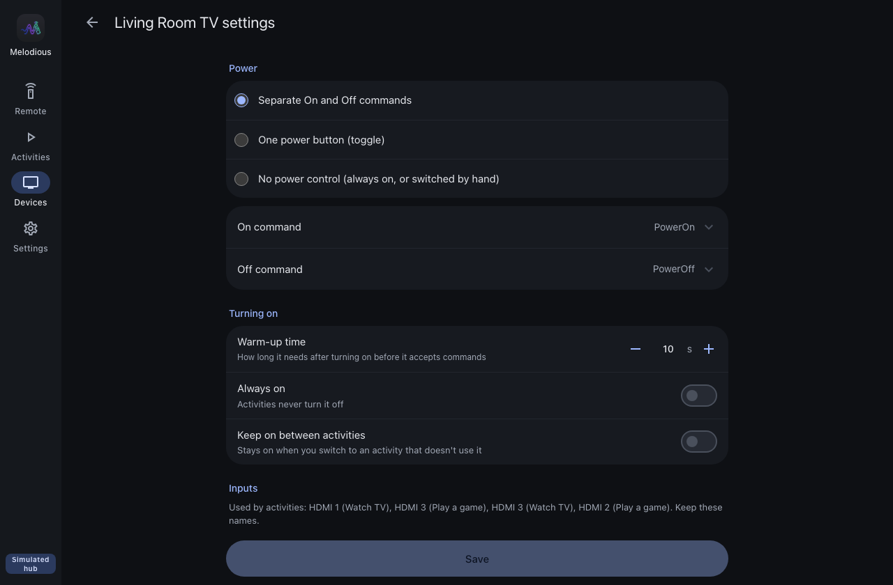

1. Under **Power**, choose what the device actually supports:
   - **Separate On and Off commands**: choose **On command** and **Off
     command**, after testing both. Prefer this whenever available: sending
     On twice stays on, so missed commands are easier to recover from.
   - **One power button (toggle)**: choose **Power command**. Each send
     reverses power, so using the original remote or the device's front
     button can put the hub's remembered state out of step.
   - **No power control (always on, or switched by hand)**: activities send
     no power commands. Use this for devices you genuinely leave running
     or power manually, not to cover up a broken power code.
2. Under **Turning on**, set **Warm-up time**. This is the device's
   **power-on delay**: how long it needs before accepting commands after
   waking. A TV may need **5–10 seconds**, sometimes more, before an HDMI
   switch works. Start conservatively, then shorten after reliable tests.
3. Decide whether to enable:
   - **Always on**: activities never turn this device off. This is a
     separate switch from choosing **No power control** above.
   - **Keep on between activities**: leave it on when switching to an
     activity that does not use it. This is not the same as never turning
     it off with the overall Off action.

The activity wizard also has waits **between devices turning on**. Those
are not a substitute for setting a slow TV's own Warm-up time.

### 2. Input switching (Web/Desktop)

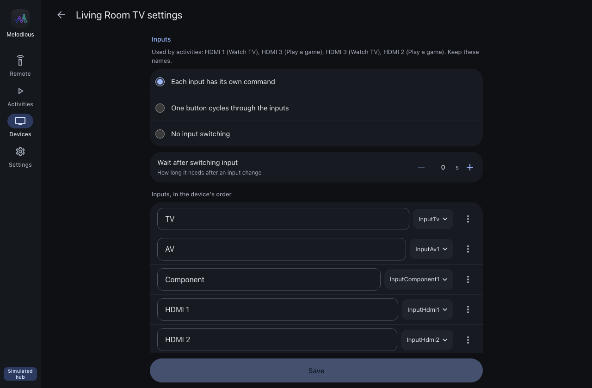

If the device has several sources, set up its inputs here **before**
choosing them in an activity. Android users can do this in the phone's
browser, then return to the app.

**Each input has its own command — preferred:**

1. Select **Each input has its own command**.
2. Use **Fill from commands** to start from the existing Input commands,
   or **Add input** for each source you need.
3. Give each input a useful name, such as `HDMI 1` or `HDMI 2`, and choose
   its actual command. Test that the command selects that physical port.
4. Set **Wait after switching input** (the input delay). Allow the device
   time to finish changing sources before the next command.

**One button cycles through the inputs:**

1. Select **One button cycles through the inputs**.
2. List inputs in the **exact order the device cycles through them**,
   including enabled inputs you do not normally use. Use each row's
   **⋮ → Move up / Move down** to correct the order.
3. Pick **Next-input command** and, if supported, **Previous-input command**.
4. Set **Input after power-on** to its known starting input. If it remembers
   whatever input it used last, do not invent a fixed starting input;
   cycling will be less dependable. Look for discrete input codes instead.
5. Set **Wait after switching input** long enough for each step to register.

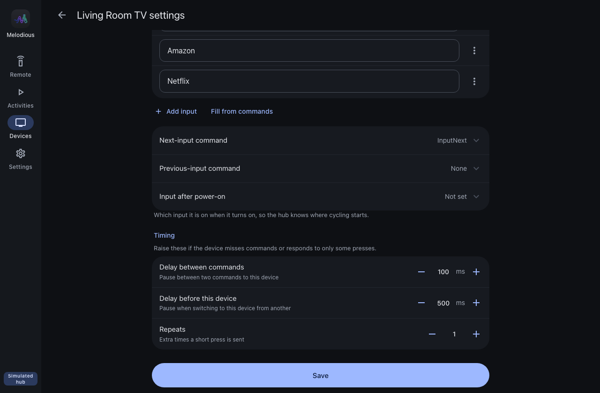

Choose **No input switching** for equipment with no selectable source.
Do not rename/remove inputs already used by activities without updating
the activities first; the editor protects inputs still in use. Network
Android/Google TVs have a different input setup on this page; follow
[their guide](ANDROID_TV.md) rather than applying the IR cycling recipe.

### 3. Timing and repeats

Under **Timing**, change one value at a time and retest:

| Exact setting | What it means | When to change it |
| --- | --- | --- |
| **Delay between commands** | Inter-key delay, in milliseconds, for commands to this device | Increase if a sequence misses every second key. Lower cautiously if navigation feels sluggish. |
| **Delay before this device** | Inter-device delay, in milliseconds, when moving from another device to this one | Increase if mixed-device startup loses commands even though individual tests work. |
| **Repeats** | Extra sends for a short press | Increase a little for missed IR presses after checking placement. Lower if one tap moves two menu items. |

Repeats do not repair wrong codes or a TV that is still warming up.
Distinguish repeats for **one short press** from holding a volume key,
which intentionally repeats. Seconds (`s`) and milliseconds (`ms`) are
different: 1 second is 1,000 milliseconds.

### 4. Save and retest

Scroll to **Save**, click it, and wait for confirmation. Open the settings
again to check the values. Turn the device off, let it settle, then test
On → warm-up → input from a cold start. Test switching from another input
too. Keep the original remote handy until the activity works reliably.

## Ready for activities?

For each device, check:

- [ ] Power works, with the correct separate/toggle/manual setting.
- [ ] Every input you plan to use exists and selects the right source.
- [ ] Warm-up and input waits work from standby and when already on.
- [ ] Volume, navigation and playback commands work directly.
- [ ] Settings are saved; experimental scratch commands are not in use.

Next: **[Creating Activities & Customizing Your Remote](ACTIVITIES_GUIDE.md)**.
