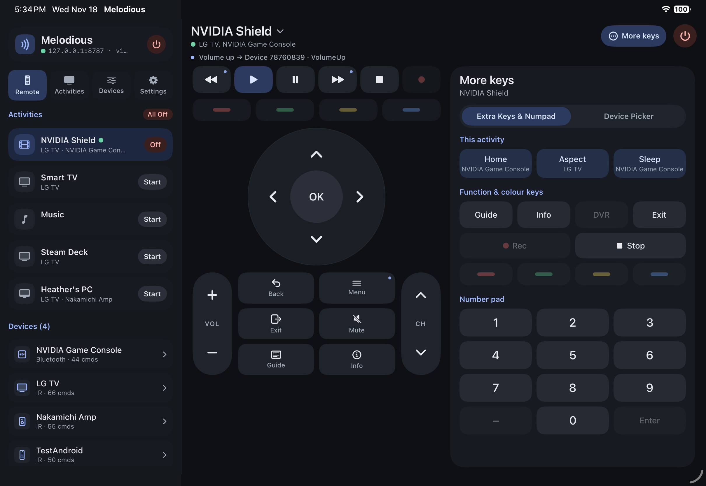
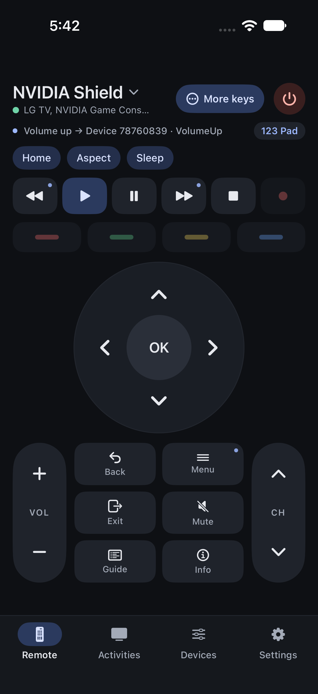
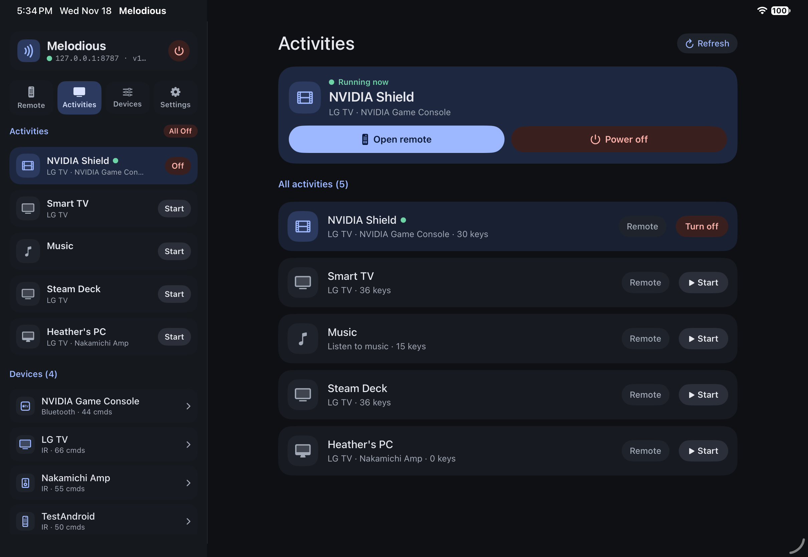
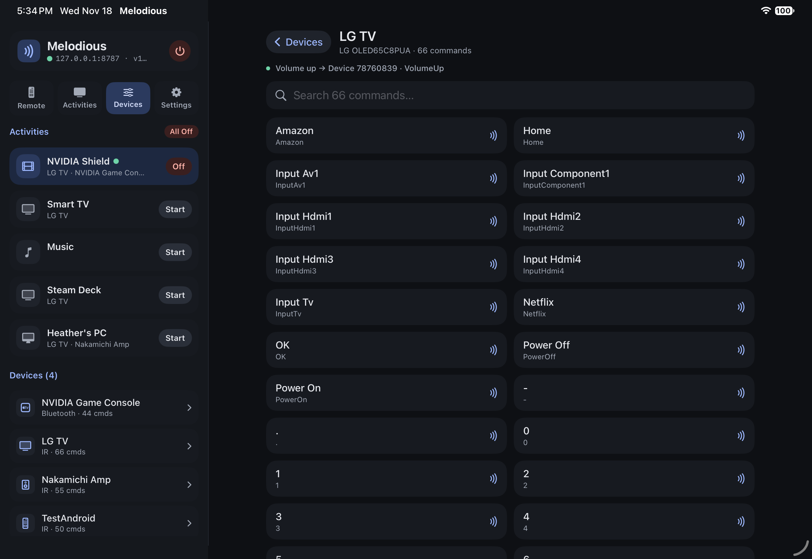
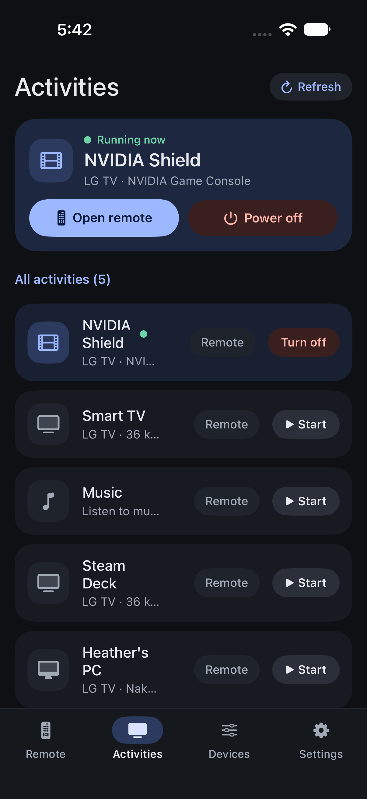
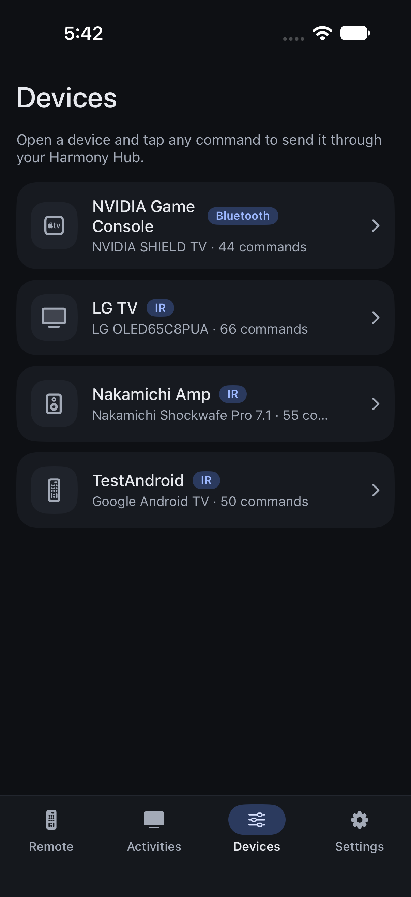

# Melodious for iOS and iPadOS (Experimental Baseline)

Melodious includes an **experimental, native Swift/SwiftUI client for iPhone and iPad** (`ios/`). It is an addition to the web app, the Android app, and the Windows/Linux/macOS desktop apps — not a replacement for any of them.

It ships with the **2.5.0** release as an **unsigned `.ipa` (`melodious-ios-2.5.0.ipa`) for sideloading** with AltStore or SideStore, or you can build and install it directly onto your iPad or iPhone from a Mac using Xcode free provisioning. It is not on the App Store or TestFlight.

> **Screenshots:** Captured directly from **iOS 27.2 Simulator** (`Xcode 27.2`) running against `tools/webui-sim` on **iPad Pro 11-inch (M5)** (`2420×1668`, landscape) and **iPhone 18 Pro** (`1206×2622`, portrait).

<table>
<tr>
<td align="center"><br><sub>iPad Pro 11-inch (M5) Simulator (iOS 27.2): hub &amp; activities sidebar, remote keypad, and More keys panel</sub></td>
<td align="center"><br><sub>iPhone 18 Pro Simulator (iOS 27.2): compact tab layout</sub></td>
</tr>
</table>

<details>
<summary>More iPad and iPhone Simulator screenshots</summary>

<table>
<tr>
<td align="center"><br><sub>iPad Simulator: Activities</sub></td>
<td align="center"><br><sub>iPad Simulator: Device commands</sub></td>
</tr>
<tr>
<td align="center"><br><sub>iPhone Simulator: Activities</sub></td>
<td align="center"><br><sub>iPhone Simulator: Devices</sub></td>
</tr>
</table>

</details>

---

## 1. Requirements

- **iPhone or iPad running iOS / iPadOS 17.0 or later** (universal target, adaptive split view on iPad and compact tab bar on iPhone).
- **A Harmony Hub already set up with Melodious** on the same local network (`http://<hub-ip>:8080` and HBus WebSocket on `:8088`). To root and set up a hub for the first time, use the [Desktop Setup Wizard](SETUP_GUIDE.md) or the [CLI installer](INSTALL.md).
- **For sideloading:** [SideStore](https://sidestore.io/) or [AltStore](https://altstore.io/), or a Mac with Xcode for direct free-provisioning install.

---

## 2. What the experimental baseline does (and does not do)

### Included in the 2.5.0 baseline

1. **Hub connection & discovery**
   - Connect manually by IP address or hostname and optional port (default `8080`, or `8787` for `tools/webui-sim`), with optional HTTP Basic authentication.
   - **Local `/24` subnet scan** (`:8080/api/version`). Sideloaded iOS apps cannot use Apple's restricted `com.apple.developer.networking.multicast` entitlement for SSDP multicast (`239.255.255.250:1900`), so the iOS app sweeps the local `/24` subnet over HTTP directly.
   - **Saved-hub persistence:** remembers your saved hubs and automatically reconnects to the last used hub on launch.
   - Displays hub firmware (`GET /api/system-status`), Melodious software version, and supported feature flags (`GET /api/version`), with clear error states when a hub is unreachable.
2. **Activities**
   - Lists activities from `GET /api/activity-config`, shows which activity is currently running via live state-digest polling (`GET /api/state`, `GET /api/activity-state`) and HBus WebSocket push events (`:8088`), starts activities (`POST /api/activity-run`), and turns everything off (`PowerOff`).
3. **Native SwiftUI Remote**
   - D-pad (`Up`, `Down`, `Left`, `Right`, `OK`/`Select`), `Back`, `Exit`, `Menu` (automatically labelled `Home` when mapped to a Home command), `Guide`, `Info`, `DVR`, volume up/down/mute, channel up/down, playback transport (`Play`, `Pause`, `Stop`, `Rewind`, `FastForward`, `Record`), colour keys (`Red`, `Green`, `Yellow`, `Blue`), and a `123` number pad.
   - **Press / hold / release semantics:** repeatable keys (volume, channel, D-pad) act immediately on finger press-down and repeat every 200 ms after a 380 ms hold delay over the hub's `:8088` HBus WebSocket (`vnd.logitech.harmony/vnd.logitech.harmony.engine?holdAction` / `control.button?press|hold|release|fire`, falling back to HTTP `/api/ir-send` hold leases when connected to `tools/webui-sim`), while keys with long-press actions fire their secondary command at 500 ms and toggle commands remain one-shot.
   - **More keys & Device picker:** on-screen soft buttons for the running activity (`16417Activity<id>`), secondary and colour keys, number pad, and a device picker to send any command to a specific device.
4. **Devices (read-only command sender)**
   - Lists all configured hub devices with transport badges (`IR`, `Bluetooth`, `Home Assistant`, `Network TV`) and searchable command grids to send individual commands.
5. **Settings**
   - Hub address/port, subnet scanner, saved hubs, hub version & feature flags, app version (`2.5.0`), and sideloading help.

### Not in the experimental baseline

Use the hub's web app (`http://<hub-ip>:8080/`), the desktop app, or the Android app for features outside this baseline:

- Activity and device creation or editing (Activity Wizard, button remapping, Touch screen editor, device power/input/timing settings)
- Hub Setup Wizard / rooting and SSH recovery or hub updates
- Logitech catalog sign-in and lookup, IR learning, and IRDB / Pronto / Flipper code import
- Home Control button editing and Home Assistant device state strips
- Bluetooth keyboard pairing and text entry
- Sleep timer
- iOS Widgets, Siri Shortcuts, Live Activities, and background refresh

---

## 3. Sideloading `melodious-ios-2.5.0.ipa` (AltStore & SideStore)

The release asset `melodious-ios-2.5.0.ipa` is an unsigned application archive (`Payload/Melodious.app`). Sideloading tools re-sign it on the fly with your own Apple ID.

### Option A: SideStore (recommended for iPad & iPhone)

1. Install and set up [SideStore](https://sidestore.io/) on your iPad or iPhone (requires a one-time pairing file from a computer and the local WireGuard loopback profile used by SideStore).
2. Download `melodious-ios-2.5.0.ipa` from the [Melodious release page](https://github.com/schlambos/harmony-hub-control/releases) onto your iPad or iPhone.
3. Open **SideStore → My Apps**, tap **`+`** in the top corner, and pick `melodious-ios-2.5.0.ipa`.
4. When you first open **Melodious**, iOS will ask: *"Melodious would like to find and connect to devices on your local network."* Tap **Allow**.

### Option B: AltStore

1. Make sure **AltServer** is running on your Mac or Windows PC on the same Wi-Fi network (or connect your device over USB).
2. Download `melodious-ios-2.5.0.ipa` on your iPad or iPhone.
3. Open **AltStore → My Apps**, tap **`+`**, and select `melodious-ios-2.5.0.ipa`.
4. Launch **Melodious** and tap **Allow** when prompted for Local Network access.

### The 7-day free Apple ID refresh reality

- **7-day expiry:** Apps signed with a free Apple ID ("Personal Team") receive a provisioning profile from Apple that expires after **7 days** (paid Apple Developer Program accounts last 365 days). You can also have at most **3 active sideloaded apps** installed at a time with a free Apple ID (including AltStore/SideStore itself).
- **Refreshing:**
  - **SideStore** can refresh Melodious directly on your iPad or iPhone over Wi-Fi (including background refresh when enabled in SideStore) without needing a computer running.
  - **AltStore** refreshes Melodious over Wi-Fi or USB whenever AltServer is running on your Mac or PC.
- If the 7-day window lapses before a refresh, simply tap **Refresh All** in SideStore or AltStore (or re-run from Xcode); your saved hubs in Melodious remain intact as long as you do not delete the app.

---

## 4. Running on your iPad or iPhone via Xcode free provisioning

If you have a Mac with Xcode, you can build, sign with a free Apple ID, and install straight onto your iPad or iPhone without AltStore or SideStore:

1. Open the project in Xcode:
   ```bash
   open ios/Melodious/Melodious.xcodeproj
   ```
2. In the left Project Navigator (`⌘1`), click **Melodious** (top-level blue project icon), then in the editor column select **Melodious** under **TARGETS** (not under **PROJECT**) and open the **Signing & Capabilities** tab.
3. Check **Automatically manage signing**.
4. Under **Team**, select your **Personal Team** (if you haven't added your Apple ID yet, click **Add Account…** in Xcode → Settings → Accounts; a free Apple ID works).
5. If Apple reports that the bundle identifier `app.melodious.ios` is already registered to another team in Apple's portal, append your own suffix in the **Bundle Identifier** field (for example `app.melodious.ios.yourname`).
6. Connect your iPad or iPhone to your Mac, select it as the run destination in Xcode's toolbar, and press **Run (`⌘R`)**.
7. On first install with a free Apple ID, open **Settings → General → VPN & Device Management** on your iPad/iPhone, tap your Developer App certificate, and tap **Trust** (on iOS 16+, also enable **Settings → Privacy & Security → Developer Mode** if you have not used Xcode on the device before).

---

## 5. Building the unsigned IPA and running tests from source

> **Note on CI:** As documented in [CI.md](CI.md), GitHub's hosted macOS runners are not used in this repository because of queue times. There is no GitHub Actions CI job for iOS; `melodious-ios-2.5.0.ipa` is built locally on a Mac with Xcode.

### Build the unsigned release IPA

Building `melodious-ios-2.5.0.ipa` requires a Mac with a full installation of Xcode (Command Line Tools alone do not include the iOS SDK and `./ios/build-ipa.sh` will refuse to build without Xcode):

```bash
./ios/build-ipa.sh
```

This runs `xcodebuild` (`-configuration Release -destination "generic/platform=iOS"` with code signing disabled), packages `Payload/Melodious.app` into `ios/melodious-ios-2.5.0.ipa`, and verifies with `unzip -l` and `otool` that the archive contains an iOS (`LC_BUILD_VERSION` platform 2) `Payload/Melodious.app/Melodious` executable and `Payload/Melodious.app/Info.plist` with no `_CodeSignature` and no `embedded.mobileprovision`.

### Run the unit tests and simulator against `tools/webui-sim`

On a Mac with Xcode installed (verified with **Xcode 27.2** / **iOS 27.2 Simulator**), run the 15-test XCTest unit suite (hub URL parsing, `/24` subnet candidate generation, `/api/version` + `/api/activity-config` + state-digest JSON fixture parsing, remote key → HBus press/hold/release frame sequences, and saved-hub persistence) on an iPad simulator:

```bash
xcodebuild test \
  -project ios/Melodious/Melodious.xcodeproj \
  -scheme Melodious \
  -destination 'platform=iOS Simulator,name=iPad Pro 11-inch (M5)'
```

To run the app in the iPad or iPhone simulator against the local mock hub without touching a real Harmony Hub:

```bash
node tools/webui-sim/server.mjs
```

Because iOS Simulator shares the Mac host's loopback network interface, connecting to **`127.0.0.1`** on port **`8787`** in the simulator reaches `tools/webui-sim/server.mjs` directly (the app's subnet scan also probes `127.0.0.1:8787` automatically).
