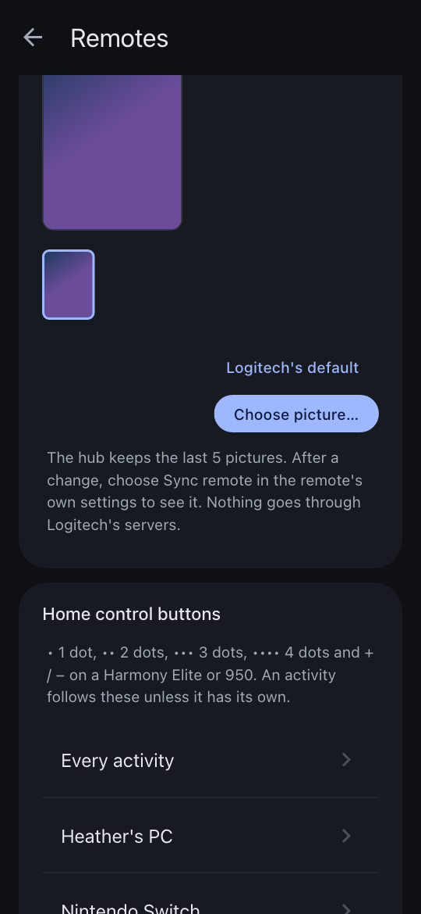

# Remote backgrounds

A Harmony remote with a screen (Touch, Ultimate, Elite, 950) shows a picture
behind its activities. Logitech's app used to upload your own; Melodious does
it on the hub, with no cloud: pick a picture in the web app, frame it, and the
remote fetches it from the hub the next time it syncs.

## Change the background

1. **Settings → Remotes**, then the section for your remote with a screen.
2. **Background → Choose picture…** and pick any picture your browser can
   open (a photo, a PNG, a JPEG).
3. Drag the picture to place it in the frame and use **Zoom** to fill it. The
   frame is the remote's screen, 3:4 upright.
4. **Use as background.**
5. On the remote, open its settings and choose **Sync remote**. The new
   background shows once the sync finishes.

The card also shows the pictures the hub keeps for this remote (the last
five): tap one to make it the background again, or **Logitech's default** to
go back to the stock picture. Each change needs **Sync remote** on the remote.

 The Background card (the picture is a plain example)

The browser does the framing and scaling, so the hub only receives a
240×320 PNG and the 60×80 thumbnail the remote's own settings page shows. A
large photo never leaves your phone or computer at full size.

## How it works

- **Where the setting lives.** The hub keeps the paired screen remote's own
  settings in its `Settings` resource: the background (`BackgroundImage`), the
  pictures saved for it (`UserImages`, newest first, at most five), screen
  brightness and so on. The remote reads them during every sync.
- **Saving a picture.** `codex_webui` checks the upload (a PNG of exactly
  240×320, and its 60×80 thumbnail) and hands it to `codexactivity`
  (`CommitRemoteBackground`), which saves both as images in the hub's resource
  store (`<name>.png`, `<name>_small.png`), makes the picture the background,
  puts it first in `UserImages` and publishes a new revision. A picture that
  drops off the list loses its files. Names follow Logitech's form,
  `<account id>_<uuid>.png`, or the uuid alone on a hub that doesn't know its
  account.
- **Fetching it.** The remote downloads its pictures from the image address in
  its settings (`UserImageBucketUri`), through the hub. The stock firmware
  always fetches images from Logitech; `netservicestarter.lua` answers instead
  with the picture saved on the hub, the way the stock image handler does (the
  PNG as the reply's binary payload). Pictures the hub doesn't have stay
  blocked, as before.

The API is in [API.md](API.md#remote-background).

## Notes

- **The hub keeps one remote with a screen,** so there is one background per
  hub. Moving a remote to another hub (or swapping hubs) leaves its settings
  and pictures on the old hub; set the background again on the new one.
- **No settings yet:** a freshly set-up hub has no settings for the remote
  until the remote has synced with it once. Choose **Sync remote** on the
  remote, then Refresh on the Remotes page.
- **The picture doesn't change:** the remote only fetches new settings when it
  syncs. Waking it or docking it isn't always enough; **Sync remote** is.
- A picture is renamed every time it's uploaded, so uploading the same file
  again makes a new copy rather than updating the old one.
