# Setting up your Harmony Hub with Melodious

Set up your Harmony Hub with Melodious on **Windows, Linux or macOS**.
This guide follows the desktop app's built-in Setup Wizard from first
launch to a hub running Melodious, with your remote paired. Packaged
Windows and macOS apps need no commands; Linux runs the same app from source.

> **Availability.** The built-in Setup Wizard is on `main` and joins the
> Windows and macOS desktop releases in the first release after `v2.1.0`.
> The `v2.1.0` app doesn't have it yet. Linux uses the desktop app from
> source. The bundled CLI works on all three platforms now:
> [`tools/hub-root/`](../tools/hub-root/README.md) for rooting, then
> `install_webui.ps1` (Windows) or `install_webui.py` (all three) for installation.
> See [INSTALL.md](INSTALL.md) for an existing Harmony setup, or
> [FRESH_HUB_ACTIVATION.md](FRESH_HUB_ACTIVATION.md) for a new, reset or used hub.

The screenshots come from a simulated hub, so the addresses and network
names in them are examples.

## Contents

- [Before you start](#before-you-start)
- [Step 0: Open Melodious](#step-0-open-melodious)
- [Choose your path](#choose-your-path)
- [Path A: Already set up in the Harmony app](#path-a-already-set-up-in-the-harmony-app)
- [Path B: Brand new, factory reset, or bought used](#path-b-brand-new-factory-reset-or-bought-used)
- [When setup finishes](#when-setup-finishes)
- [Questions and troubleshooting](#questions-and-troubleshooting)

## Before you start

You need:

- **A computer:** Windows 10/11 x64, macOS 13 or later (Apple silicon or
  Intel), or Linux with the [source prerequisites](../desktop/README.md#linux-from-source).
  Windows needs its OpenSSH Client optional feature (`ssh.exe` and
  `ssh-keygen.exe`); enable it in Windows Settings if it is missing.
- **A micro-USB data cable** for a new, reset or second-hand hub (Path B).
  Many cables that came with phones or lights only carry power and can't
  talk to the hub. If the wizard can't see a hub that's plugged in, try a
  different cable first.
- **Your Wi-Fi name and password, on a 2.4 GHz network.** Harmony Hubs
  can't join 5 GHz-only networks. Most home routers broadcast both bands,
  often under the same name.
- **About 10 minutes.**

Install the app from the
[releases page](https://github.com/schlambos/harmony-hub-control/releases):

| Platform | Install and first launch |
| --- | --- |
| **Windows** | Download `Melodious-<version>-win-x64-setup.exe` and run it, or extract `Melodious-<version>-win-x64.zip` and open `Melodious.exe`. The app is unsigned; if SmartScreen warns, choose **More info → Run anyway** after checking the download's source. Python and the USB backend are bundled; no Python installation or HID driver replacement is needed. |
| **macOS** | Download `Melodious-<version>-arm64.dmg` (Apple silicon) or `Melodious-<version>-x64.dmg` (Intel), open it and drag **Melodious** into **Applications**. The app has no Apple Developer ID: Control-click → **Open**, or **System Settings → Privacy & Security → Open Anyway**. Choose **Allow** when asked for local-network access. Python and the USB backend are bundled. |
| **Linux** | Run the desktop app from source using [`desktop/README.md`](../desktop/README.md#linux-from-source). Install Python, the USB dependencies and USB access permissions first. No Linux desktop download is published. Or use the bundled CLI in [`tools/hub-root/`](../tools/hub-root/README.md), followed by `install_webui.py`. |

## Step 0: Open Melodious

The first time you open Melodious, it goes straight to the Setup Wizard.

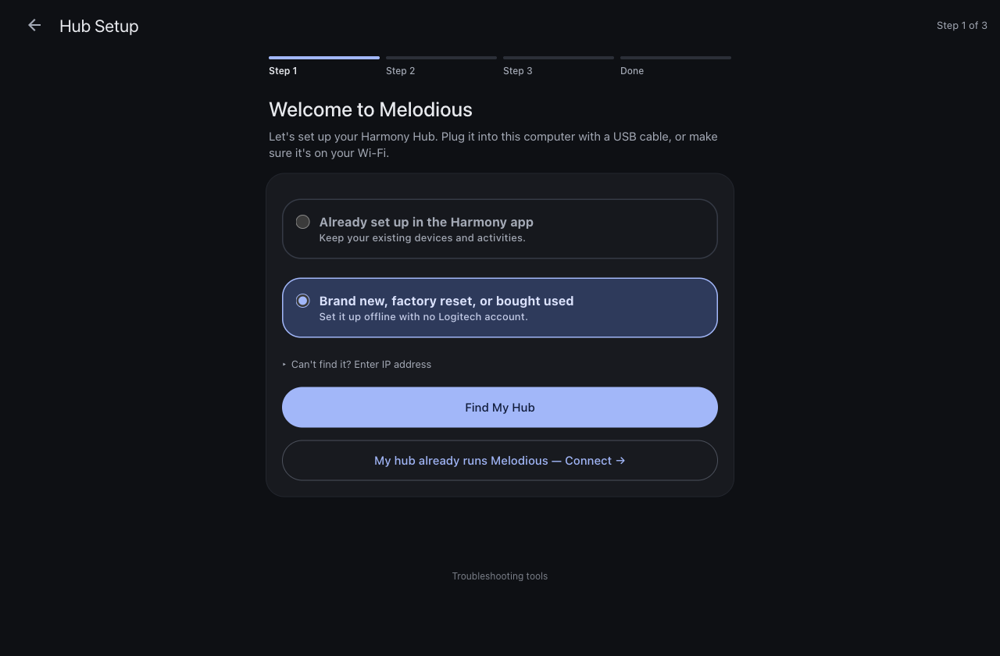

To start the wizard again later, for a second hub or a reset one, use
either of these:

- The menu bar: **File → Set Up a New Harmony Hub…** (Windows/Linux) or
  **Melodious → Set Up a New Harmony Hub…** (macOS).
- **Settings** (File → Settings… on Windows/Linux, or Melodious → Settings…
  on macOS): **Set up or re-root a hub**,
  at the top under **Current hub**.

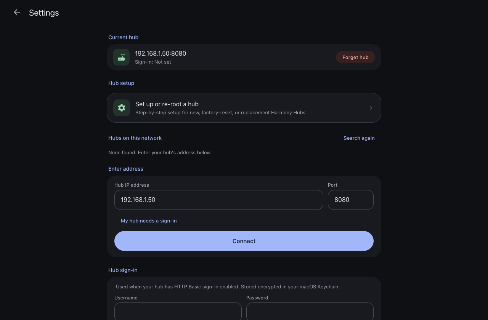

**If your hub already runs Melodious**, you don't need the wizard. Click
**My hub already runs Melodious — Connect →**. The Connect screen lists
hubs it finds on your network, or you can type the hub's address. The card
at the top takes you back to the wizard.

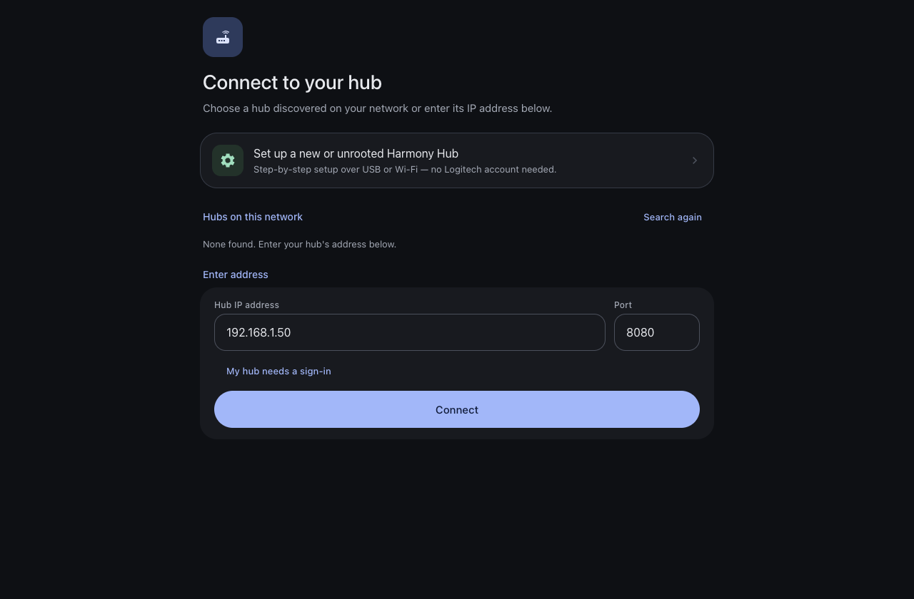

## Choose your path

On the Welcome screen, pick the choice that describes your hub:

| Your hub | Choose | What happens |
| --- | --- | --- |
| Set up with the Logitech Harmony app, and you want to keep your devices, activities and remote buttons | **Already set up in the Harmony app** (Path A) | Melodious is added next to what's there. Everything you set up stays. Usually over Wi-Fi, no cable needed. |
| New in the box, factory reset, or bought second-hand | **Brand new, factory reset, or bought used** (Path B) | The hub is set up from scratch over a USB cable, completely offline: no Logitech account or cloud. |

Not sure? Pick either and click **Find My Hub**. The wizard checks the
hub, and if it looks different from what you picked, it says so and
offers the right path before changing anything.

## Path A: Already set up in the Harmony app

### A1. Find your hub

Make sure the hub is powered on and on the same Wi-Fi as your computer, choose
**Already set up in the Harmony app**, and click **Find My Hub**.

When the hub is ready, you'll see **Harmony Hub found on Wi-Fi and ready**.
Click **Continue →**.

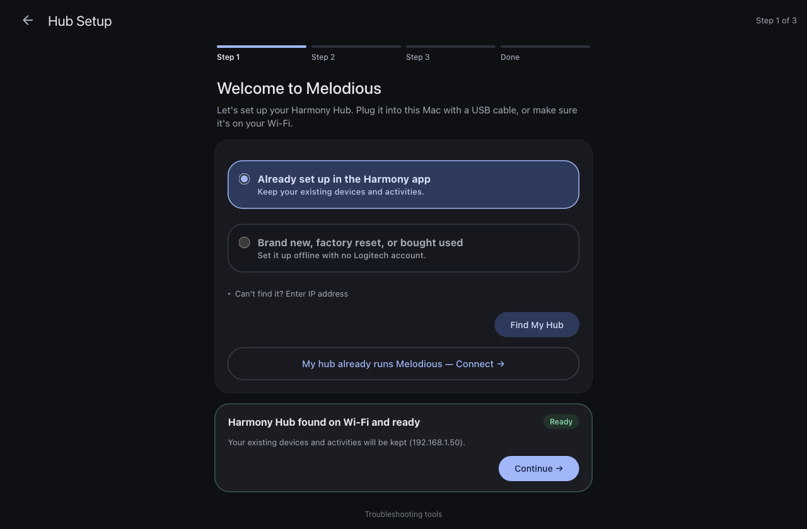

If the wizard can't find the hub, open **Can't find it? Enter IP address**
and type the address your router shows for the hub.

### A2. If you see "Turn on local access in the Harmony app"

The wizard reaches a hub that's set up in the Harmony app through XMPP, a
local connection the Harmony app can switch on. If it's off, the wizard
shows how to turn it on:

1. Open the **Harmony app** on your phone.
2. Go to **Menu → Harmony Setup → Remote & Hub → Enable XMPP**.
3. Confirm in the app, then click **Check Again** in the wizard.

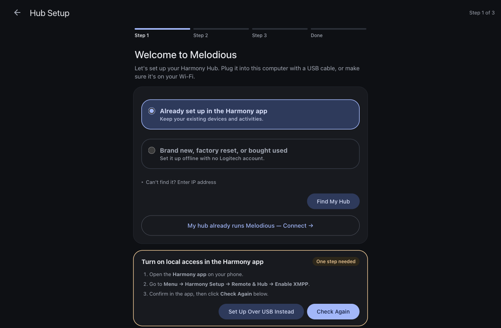

If you can't use the Harmony app any more, click **Set Up Over USB
Instead** and plug the hub into your computer with a micro-USB data cable. Your
devices and activities are still kept.

### A3. Install Melodious

The Install screen lists the four things that happen. Your existing
devices and activities are kept. Click **Install Melodious**.

Each line gets a check mark as it finishes. It takes about 2 minutes;
keep the hub plugged into power until it's done.

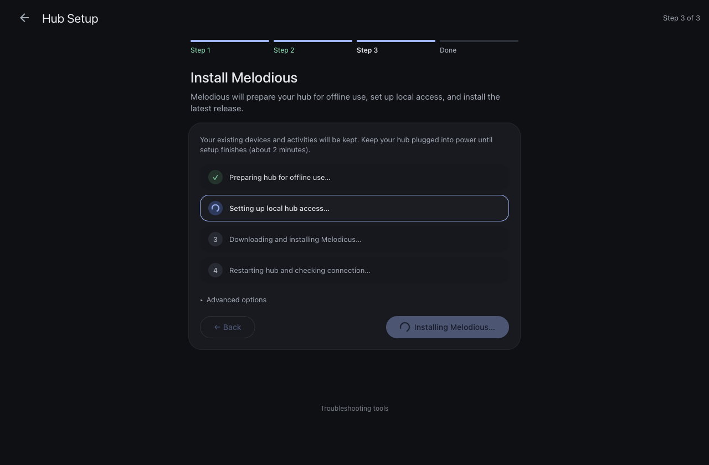

When it's finished, the wizard moves to the
[final screen](#when-setup-finishes) on its own.

## Path B: Brand new, factory reset, or bought used

This path works offline. It doesn't need the Harmony app, a Logitech
account or Logitech's servers.

### B1. Plug in and find your hub

1. Connect the hub to your computer with a **micro-USB data cable**. The cable
   also powers the hub.
2. Wait about 3 minutes for the hub's light to settle after plugging in.
3. Choose **Brand new, factory reset, or bought used** and click
   **Find My Hub**.

When the hub is ready, you'll see **Harmony Hub found over USB and ready
for setup**. Click **Continue →** and go to [B4](#b4-connect-your-hub-to-wi-fi).

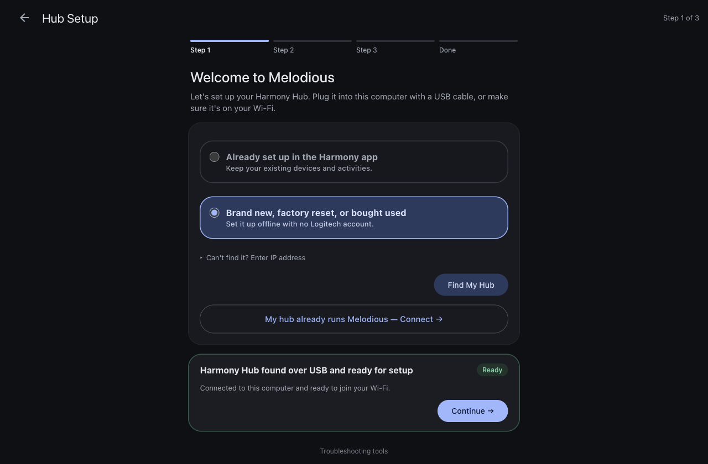

### B2. If the hub still has an old setup

A second-hand hub may still carry the previous owner's setup. The wizard
then shows **Old setup found on this hub**:

- **Keep Existing Setup** keeps its devices and activities and switches to
  Path A. Choose this if the old setup is yours.
- **Erase Hub & Start Fresh** removes the old Logitech account, devices,
  activities and Wi-Fi settings. Choose this for a hub you bought used or
  want to start over with. Your Harmony remote isn't harmed; you pair it
  again at the end.

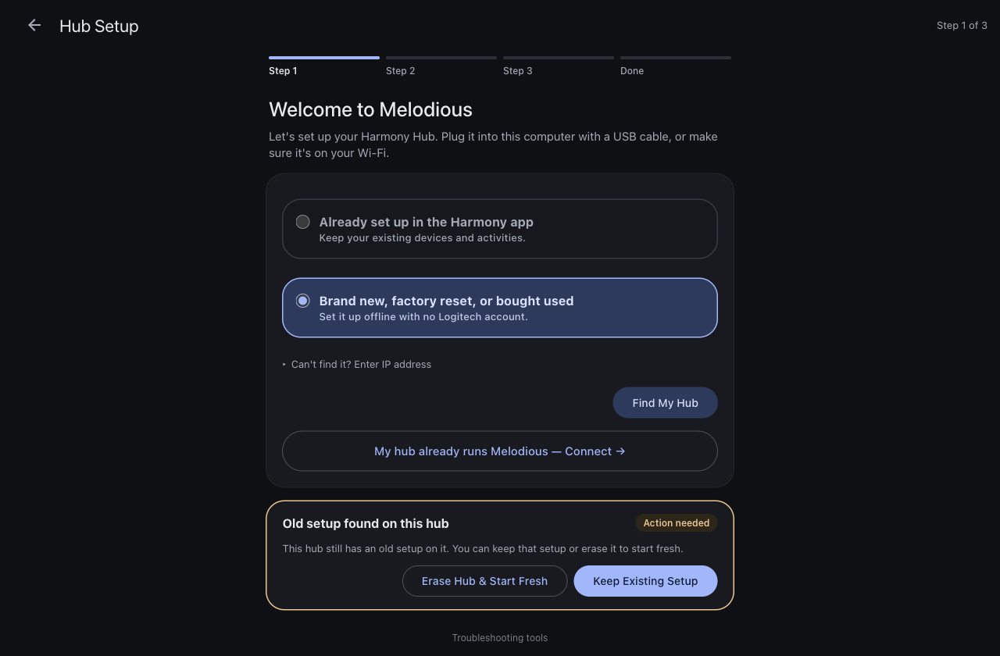

After **Erase Hub & Start Fresh**, the wizard explains what is erased.
Click **Erase Hub**. When it's done, finish restarting the hub:

1. **Unplug the USB cable from your computer for 15 seconds.** Wait until the
   fast-blinking red light stops first.
2. **Plug it back in, wait about 3 minutes** for the blinking red light to
   settle, then click **Check Hub**.

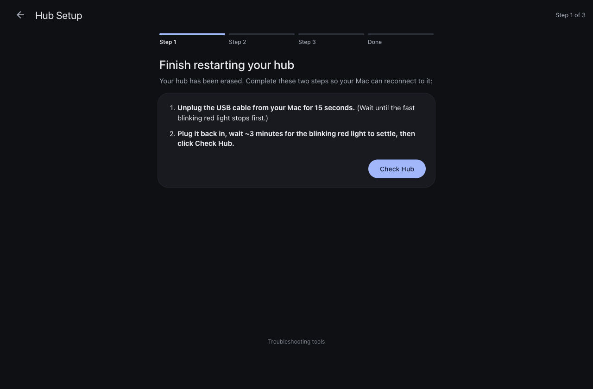

The 15 seconds matter. The cable is also the hub's power, and a full
power-off is what lets your computer see the freshly erased hub again.

### B3. If the hub needs a software update

Melodious needs the hub on Harmony software **4.15.600**, the version it's
built and tested against. The wizard checks this and only shows the
update screen when your hub is older.

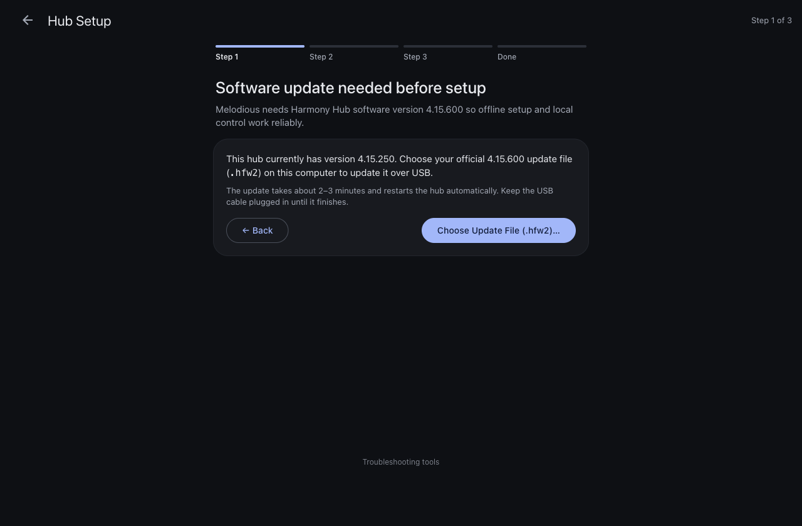

Click **Choose Update File (.hfw2)…** and pick the official 4.15.600 file
for your hub. Where to get it, and how to check you have the right one, is
in [FRESH_HUB_ACTIVATION.md, Step 1](FRESH_HUB_ACTIVATION.md#step-1--update-the-firmware-to-415600-official-signed-bundle).
The update takes 2–3 minutes and restarts the hub. Keep the cable plugged
in until it finishes. There's no going back to an older version afterwards.

### B4. Connect your hub to Wi-Fi

The wizard lists the 2.4 GHz networks the hub can see, with how strong
each one is. Pick yours (or type its name), enter the password, and click
**Connect to Wi-Fi**.

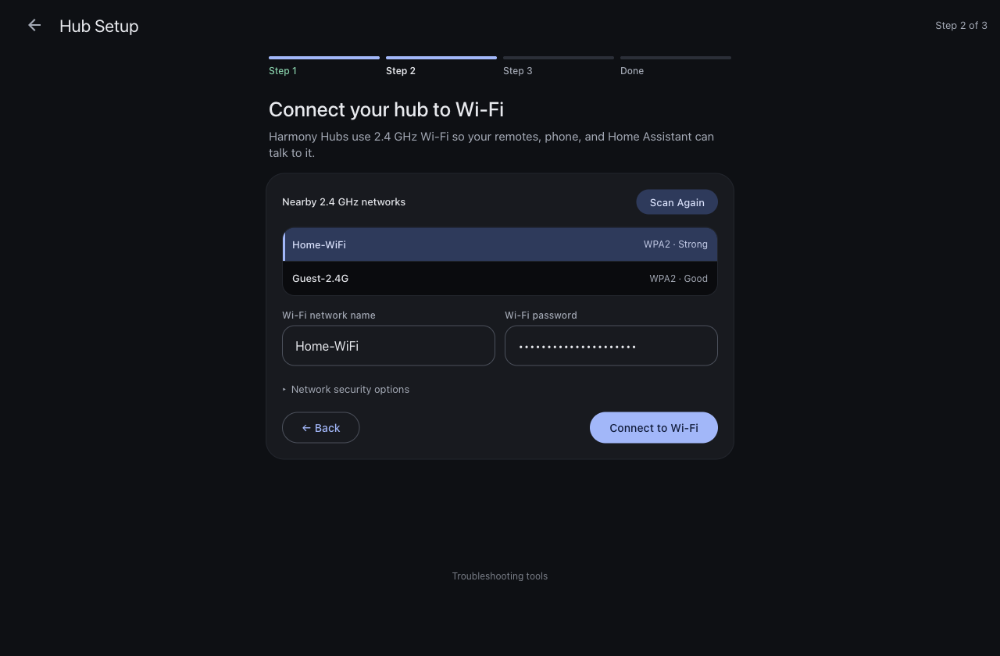

When the hub has joined, the wizard shows **Connected to** your network
and the hub's address. Click **Continue →**.

If your network doesn't appear, click **Scan Again**, or type the name.
For an open network with no password, choose it under **Network security
options**.

### B5. Install Melodious

Click **Install Melodious**. Keep the USB cable plugged in. The hub
restarts twice, and it takes about 2–3 minutes.

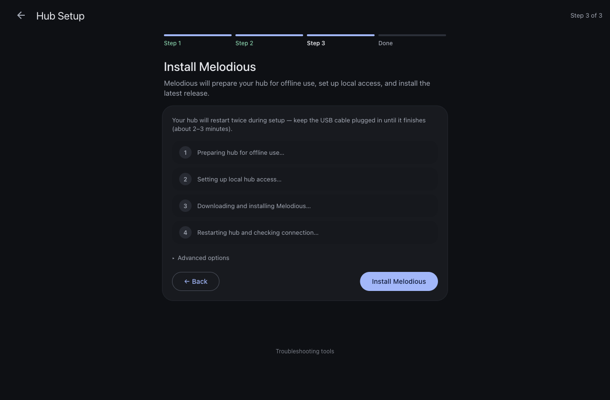

What the four lines mean:

1. **Preparing hub for offline use** sets the hub up with a local account
   instead of a Logitech one, so it never needs Logitech's servers.
2. **Setting up local hub access** gives your computer a secure key to the hub,
   so Melodious can be installed and updated.
3. **Downloading and installing Melodious** downloads the latest Melodious
   release for the hub, checks it and installs it.
4. **Restarting hub and checking connection** waits for the hub to come
   back with Melodious running.

**Advanced options** (hub name, a specific Hub ID, or installing from a
`.zip` you downloaded yourself) can be left alone.

## When setup finishes

The wizard shows **Your Harmony Hub is ready!**, with the hub's address and
the Melodious version it's running.

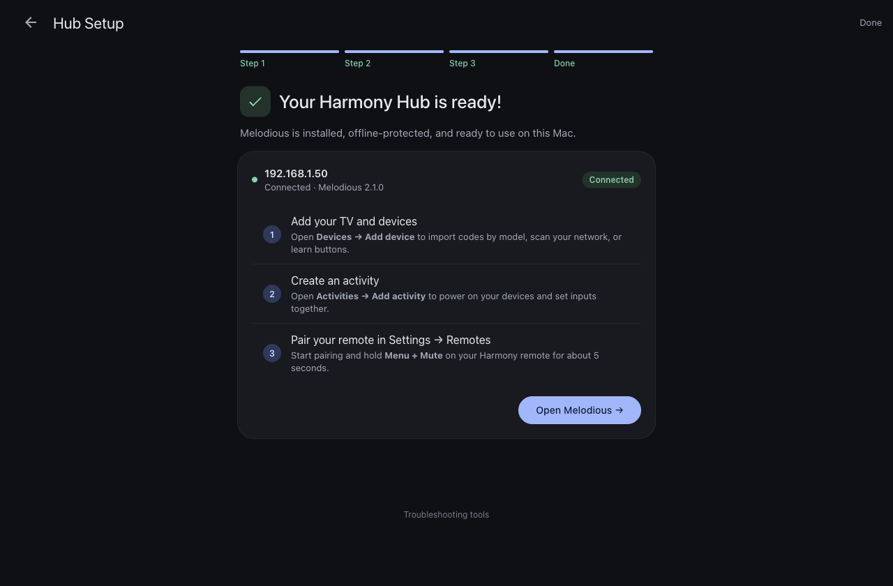

Click **Open Melodious →**. The app opens your hub's own Melodious
screens: Remote, Activities, Devices and Settings. The same screens are on
any phone or computer on your network at `http://<hub address>:8080/`.

A hub you set up with Path A already has your devices and activities.
For a new hub, do these three things:

1. **[Add your TV and devices](DEVICES_AND_CODES_GUIDE.md).** Follow
   **Adding Devices & Importing IR Codes** for the Desktop app on Windows,
   Linux and macOS, the Web UI, and Android: choose the right device type,
   import or learn commands, then configure power, inputs and timing.

   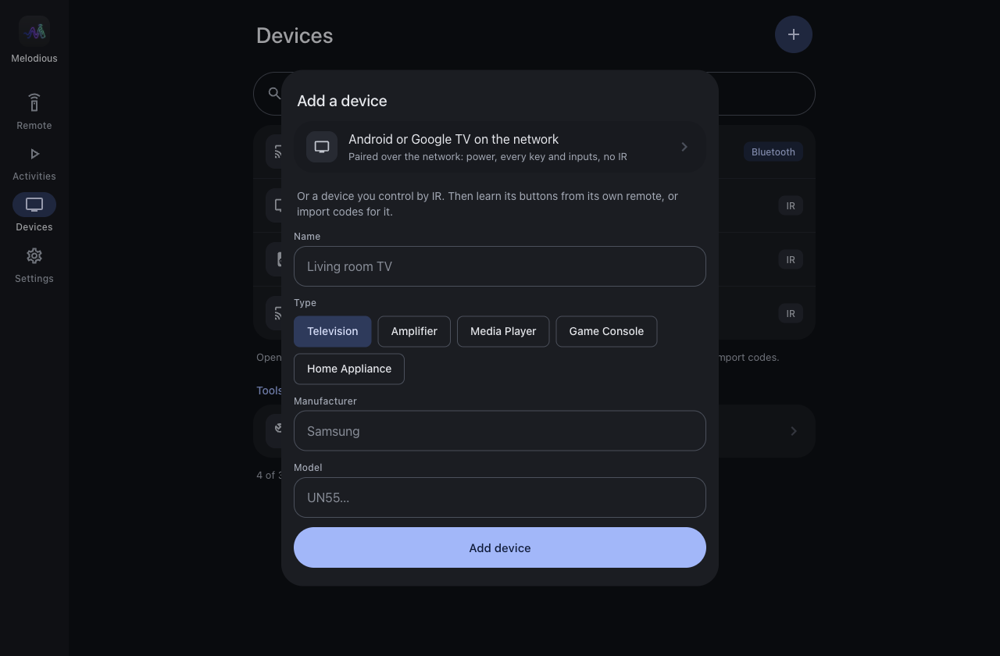

2. **[Create an activity](ACTIVITIES_GUIDE.md).** Follow **Creating
   Activities & Customizing Your Remote** to choose devices and inputs,
   set up press/hold actions, screen and Home control buttons, and test an
   activity such as "Watch TV" from start to finish.
3. **Pair your remote.** Go to **Settings → Remotes** and click **Open
   pairing window**. On a Harmony Smart Control, hold **Menu** and **Mute**
   together for about 5 seconds. Other remotes use their own pairing steps.

   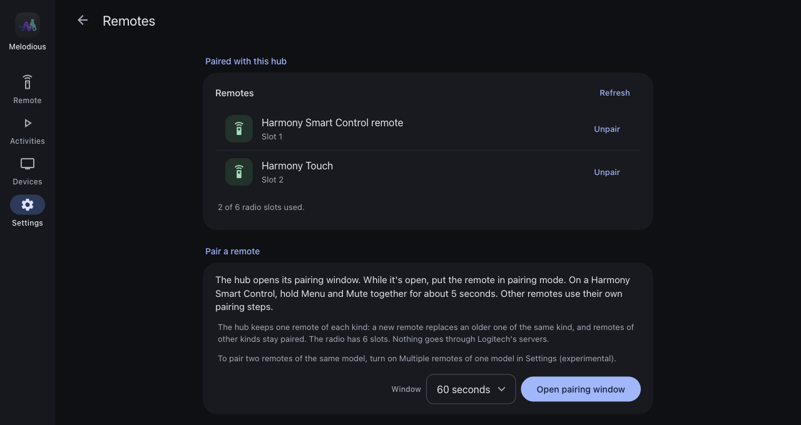

   (This screenshot is from a simulated hub that already has remotes
   paired.)

**Home Assistant (optional).** To control the hub from Home Assistant and
use Home Assistant devices on your remote, see
[Set up Home Assistant](HOME_ASSISTANT.md#setup).

**Updates.** When a newer Melodious is out, **Settings → Updates → Update
hub…** in the desktop app installs it. It uses the key the wizard created on
your computer (`~/.ssh/harmony_owner_ed25519`, or
`%USERPROFILE%\.ssh\harmony_owner_ed25519` on Windows), so keep that file.

## Questions and troubleshooting

**The wizard can't find my hub over USB.**
Most often the cable only carries power. Try another micro-USB cable,
plugged straight into the computer (not a USB hub or dock), and wait about 3
minutes after plugging in before clicking **Find My Hub** again.

**My Wi-Fi network isn't in the list.**
The hub only sees 2.4 GHz networks. If your router has separate 2.4 GHz
and 5 GHz names, pick the 2.4 GHz one. If it has a 5 GHz-only mode,
turn on 2.4 GHz in the router's settings.

**The wizard says "Your hub needs a 15-second power reset", or setup
stops partway.**
The USB link to the hub sometimes stops responding, especially after
an erase or a restart. Unplug the USB cable **at the computer end** for 15
seconds, plug it back in, wait about 3 minutes for the light to settle,
then click **Try Again** or **Find My Hub**. The wizard remembers what's
already done and carries on from there.

**Setup paused with an error.**
The step that stopped is marked, with a plain-English hint. Follow it and
click **Try Again**. **Show technical details** reveals the log if someone
helping you asks for it.

**A box asks to "Trust & Continue" about a security key.**
This can appear when you run setup on a hub your computer has connected to
before, and the hub's security key no longer matches the one your computer
saved. That's normal after a reset or a re-setup. If you reset or set up
this hub again yourself, click **Trust & Continue**. If you didn't,
cancel and check that you have the right hub.

**Does Melodious erase my devices and activities?**
Not on Path A, and not on Path B unless you click **Erase Hub & Start
Fresh**. The wizard never erases anything without that click.

**Someone helping me asked for "Troubleshooting tools".**
That link is at the bottom of every wizard screen. It holds individual
setup steps for diagnosing a problem. You don't need it for a normal
setup.

**Do I need Python or a terminal?**
Not with a Windows or macOS release that includes the wizard: Python is
bundled. Linux source users need Python and USB dependencies installed
first. If you prefer commands on any platform, use
[INSTALL.md](INSTALL.md) and [FRESH_HUB_ACTIVATION.md](FRESH_HUB_ACTIVATION.md).

**Linux sees the hub but can't use USB.**
Install `tools/hub-root/requirements-usb.txt` in the tool's `.venv` and
make sure your user has access to the USB device (see the
[USB setup instructions](../tools/hub-root/README.md#usb-setup-and-diagnostics)). Linux
needs the `hidapi` backend; a missing `/dev/hidraw*` node is expected for
Harmony Hubs. Don't run the desktop app as root.
